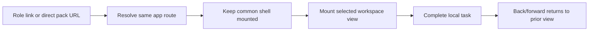
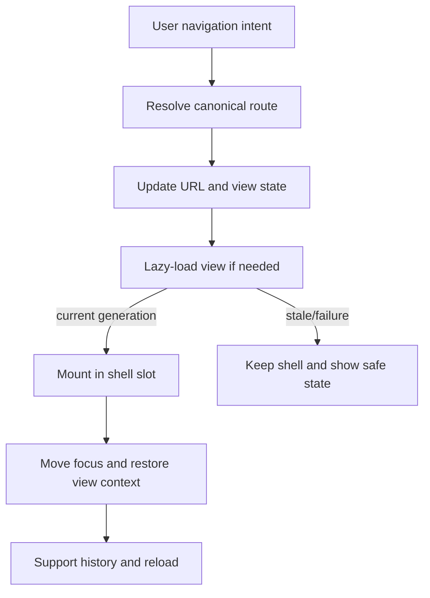
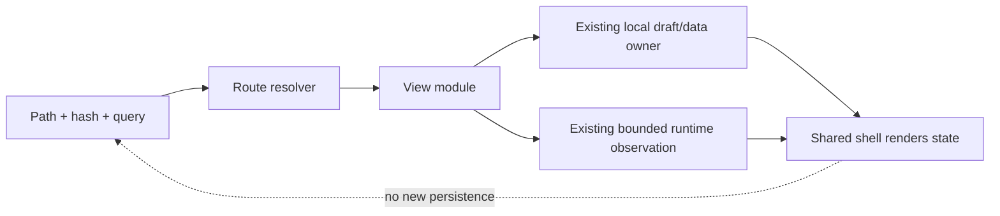
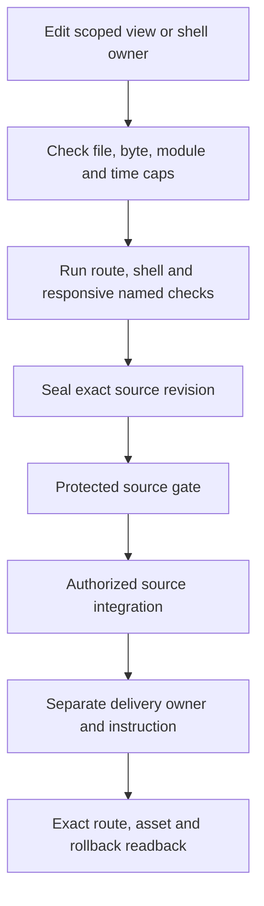
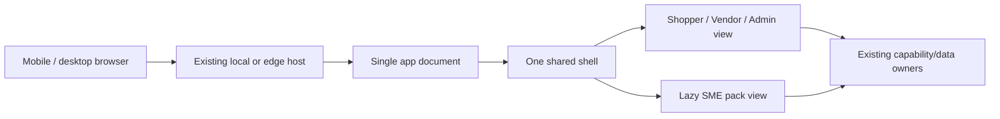

# Commerce Workspaces and Shared Shell

**Join:** `COMMERCE-CONTROL-PLANE-001@0.1.0`. This parent-level proposal specifies one persistent workspace shell across Shopper, Vendor, Admin and the SME pack. The feature companion continues to own its existing workspace implementation details; the first-dollar learning record remains the sole owner of validation/payment learnings. This document does not claim the shell consolidation is implemented.

**Objective:** switching workspace roles or opening the SME pack changes the active view while one app document keeps the shared header, navigation rail, contextual side panel and footer mounted. Route, focus, scroll and responsive state remain coherent, including direct entry, reload, back/forward and offline use.

## Reference implementation — Agentic Commerce OS

Only this block names repository-specific source facts. The requirements and architecture below remain portable.

| Source / revision | Exact observation | Product consequence |
|---|---|---|
| `agentic-commerce-os` / `88bd730c8f35da249fb23349c50820cc1932a95c` | `public/local-first/index.html` contains the role views and shared `.topbar`; `public/local-first/sme-business-pack.html`, `sme-business-pack.css` and `sme-business-pack.js` form a separate document/surface. The main document links to `services/sme-business-pack/`. | Current route crosses document boundaries; perceived refresh is expected. Same shell is a new acceptance target, not a current property. |
| Same revision | `public/local-first/style.css`, `workspace.js`, `graph-ui-tokens.css` and `scripts/local-first-release/artifact.mjs` define local presentation/build boundaries. The release checker selects the local-first output. | Extend the current native shell/style owner and release projection; do not create a second header/sidebar/footer or token profile. |
| Same revision | `docs/prd-tad-adr-mvp-gtm-edge-commerce-agent.md` (`edge-commerce-agent-mvp@0.23.0`) owns product/commerce capability contracts; `docs/prd-tad-adr-mvp-gtm-commerce-workspaces.md` (`0.25.0`) is an implementation companion. `docs/prd-tad-adr-mvp-gtm-20260909T1320Z-solopreneur-mvp-gtm.md` owns first-dollar learning. | Keep this as shell/route continuity; do not fork the roadmap, capability registry, payment ledger or learning owner. |
| `agentic-os` / `3405dc1246a1b32cfb10c044602505c4cf169c48` | Runtime policy and ADLC contracts require exact scoped source and delivery evidence; no policy grants UI code authority to publish or settle. | Role navigation is presentation state only; existing capability/effect owners remain authoritative. |

### Native design adoption record

These are current single owners at the inspected source revision, not claims of completed parity.

| Concern | Native owner at exact revision | Reused surface or utility | Acceptance check and result | Gap / next check |
|---|---|---|---|---|
| Identity and illustration | `public/local-first/index.html` at `88bd730c8f35da249fb23349c50820cc1932a95c` | Existing product brand and inline assets | `commerce-shell-singleton-check` — not run | Inventory asset rights before any new use. |
| Settings and preferences | `public/local-first/workspace.js` at the same revision | Existing navigation/view state | `commerce-route-history-check` — not run | Do not add a second preferences store. |
| Tokens and render adapters | `public/local-first/graph-ui-tokens.css` plus `style.css` at the same revision | Existing generated token projection | `commerce-shell-singleton-check` — not run | Verify source digest and all role views. |
| Typography and ideograms | `style.css` and `index.html` at the same revision | Current type and icon treatment | `commerce-responsive-shell-check` — not run | Contrast, font fallback and icon labels need browser evidence. |
| Editor surface | Role content in `index.html`; separate pack surface in `sme-business-pack.html` at the same revision | Move pack view into one content slot | `commerce-shell-continuity-check` — not run | Current document boundary is divergent; no integrated parity claimed. |
| Status and evidence | Existing status/readiness owners projected through `workspace.js` at the same revision | Preserve loading, stale, empty and failure states | `commerce-route-race-check` — not run | Runtime observation source and human comprehension require separate evidence. |

## PRD

### User, pain and evidence

**P1 — observed transition, unvalidated buyer pain:** a person selecting the SME pack leaves the current app document and enters a standalone document. This replaces the shared header and navigation and resets document-level UI state. The route/link/source boundary is observed at the pinned revision; its frequency, task loss, delay and buyer impact are not measured. Reuse one shell to reduce interruption; do not claim savings before timing real tasks.

| Role | Job | Evidence state |
|---|---|---|
| Shopper | Browse a local offer preview and understand its current state. | Existing role view observed; user study absent. |
| Seller / Vendor | Prepare and inspect a product or offer. | Existing role view and draft boundary observed; willingness to pay unknown. |
| Operator / Admin | Navigate projects and inspect bounded environment evidence. | Existing view observed; complete operational product not claimed. |
| SME pack user | Check a listing and understand gaps without saving input. | Standalone interface observed; user acceptance absent. |
| Maintainer | Change a view once while preserving shared shell behavior. | Target job; integration cost not measured. |

### Pain-to-feature, journey and criteria

| Pain / rank | Hook → break → fix → close | Minimum change and value hypothesis |
|---|---|---|
| P1, rank 1: route transition replaces shell | Click SME pack → document reloads and replaces top/side navigation → render the pack as a view inside the already mounted shell → return to same role/context and use back/forward. | Reuse one shell, route resolver and native style owner; adapt pack markup and event boundary. Measure transition time, focus continuity and support reports before savings claims. |
| P2, rank 2: role-specific shell drift | Switch role → header/rail spacing or control position differs → shared semantic layout tokens and one component owner → compare same viewport and shell state. | Reuse current theme token mapping; do not impose another product’s palette. |
| P3, rank 3: mobile navigation inconsistency | Collapse/expand side rail → ARIA state or content width disagrees → one state owner with ellipsis on constrained labels → keyboard/touch path stays reachable. | Reuse the existing navigation owner; no duplicate mobile variant. |

**Journey:** enter any role or direct URL → resolve route in the shared host → keep shell mounted → replace only the workspace slot → retain or deliberately reset local state by a documented rule → return via browser history. A route transition must never masquerade as a network failure or erase local drafts.

| VCC | Given / when / then | Named check | Constraint |
|---|---|---|---|
| COM-01 | Given Shop, Vendor, Admin or SME pack route, when changing route, then one shell root/header/nav/side panel/footer remains mounted and only the workspace slot changes. | `commerce-shell-continuity-check` | No full document navigation or duplicated shell DOM. |
| COM-02 | Given direct SME path, reload and browser back/forward, when the route resolves, then the same shell and intended view appear with correct canonical URL. | `commerce-route-history-check` | No redirect to a separate app document; preserve query/hash context. |
| COM-03 | Given a role switch at one viewport, when shell views are compared, then header, rail, side panel, footer, spacing and shared controls use one owner and consistent geometry. | `commerce-shell-singleton-check` | Role content may differ; shell has no per-role layout override. |
| COM-04 | Given 320/360/390/768/1280 CSS px and 200% text zoom, when using every role and the pack, then content reflows, labels ellipsize safely, controls remain reachable and no page-level horizontal overflow occurs. | `commerce-responsive-shell-check` | Inner data tables may scroll in labelled regions. |
| COM-05 | Given keyboard, touch and reduced-motion use, when navigating/opening/closing side panel, then focus, expanded state, Escape and ≥44 px targets are correct. | `commerce-shell-accessibility-check` | Do not claim human or physical-device acceptance from automation alone. |
| COM-06 | Given a route transition or slow pack module, when loading, failing or cancelling, then shell remains usable, error is explicit, input remains local and late results cannot overwrite the active route. | `commerce-route-race-check` | No automatic destructive retry or hidden state loss. |
| COM-07 | Given a primed local-first cache without network, when opening and navigating the views, then local views remain available and runtime-dependent facts show unknown/stale accurately. | `commerce-shell-offline-check` | Offline does not imply settlement, publication or live readiness. |
| COM-08 | Given any role or pack action, when exposed in human and agent surfaces, then existing invocation schema/effect owners stay unchanged; shell navigation creates no capability or authority. | `commerce-capability-boundary-check` | Reads/preparation do not grant writes or payments. |

**Must:** one mounted shell and route slot, stable direct routes/history, one responsive navigation/side panel/footer owner, accurate loading/error states, offline local behavior, existing role and effect boundaries. **Should:** transition analytics stored only as opt-in local pilot observations. **Could:** unified deep-link catalog after route contract settles. **Won't:** new role-specific shells, automatic synchronization, new identity or settings service, remote telemetry, new payment/order authority, paid service or model calls.

The Agentic OS-ready status surface, AI Agent-ready discovery/execution surface, and MCP Gateway-ready federation remain unchanged. This shell increment grants no invocation, model, approval, publication or payment capability and does not promote any of those readiness dimensions.

### Metrics and TTV

| Metric | Baseline | Target / window |
|---|---|---|
| Role-to-pack route continuity | Current source has separate document; no timed task baseline. | One-document transition in direct route/back-forward checks; time five users/tasks before savings claim. |
| Shared shell drift | Not exhaustively measured. | Zero duplicated shell owners and zero per-role layout override at candidate release. |
| Task completion / TTV | Unknown. | Measure open role → pack → review report; ≤60 seconds is a hypothesis, not acceptance evidence until five observed tasks. |
| Mobile reach | Existing browser coverage is not complete parity proof. | 320/360/390/768/1280 plus 200% zoom and keyboard/touch checks; human-device acceptance open. |
| Incremental spend/tokens | Current infrastructure spend is separately owned. | $0 new recurring spend; 0 model calls/tokens; fail closed on unknown quota/cost. |

## Market, offer and alternatives

Initial geography hypothesis: Singapore micro and small merchants. SingStat reports 371.0k enterprises and 369.5k SMEs in 2025; this is an upper population bound, not the addressable market. IMDA’s 2026 refreshed retail plan describes 2,095 eligible/interested retail enterprises for a sector-specific solution; that is not observed demand for a persistent commerce workspace. SingStat’s S$435.2B 2024 e-commerce-services revenue is transaction activity, not software spend.

| Sizing method | Formula / population | Evidence and limitation |
|---|---|---|
| Population top-down | TAM = eligible merchant organizations × observed annual product price; use the 371.0k broad ceiling, then narrow only with segment evidence. | Price and fit unknown; monetary TAM unresolved. Retail’s 2,095 population is a contextual bound only. |
| Capacity-based bottom-up | SOM = reachable qualified merchants × observed paid conversion × collected price, limited by onboarding/support capacity and cycle length. | No prospect list, conversion, price, cycle or service capacity sample; SOM unresolved. |

Current alternatives: keep separate local pages; use manual links between tools; build no combined workspace; or use a FOSS route/shell adapter around existing capabilities. The manual/no-change path costs the least today. A hosted subscription, take-rate or paid setup is not selected absent evidence. The first-dollar owner keeps its existing ranked hypotheses: concierge setup/recovery, recurring hosting, then take-rate; none is validated by this proposal. No contact or payment occurs as part of this spec.

## TAD

### One shell and routing contract

The app document owns one `WorkspaceShell`: header, role/workspace navigation, single side panel, content slot and shared footer. A route resolver reads pathname plus existing hash/query context and selects a view module. Role changes update route and current-view state; SME content is loaded into the slot and unmounted independently. Use existing router/history conventions if present; if none can represent the direct service path, add one thin path adapter and configure the existing local/edge host to serve the same app document at that path. Do not create a parallel router or an extra shell.

Maintain one shell DOM identity across route changes. Preserve user input and scroll when returning to a view unless the view’s existing contract explicitly resets it; restore focus to the destination heading or initiating control. Use `pushState` for user navigation and `popstate` for back/forward; direct entry and reload must resolve the same view. Route-level async work carries a navigation generation/abort signal; stale responses are discarded. A missing route is explicit and recoverable in the same shell.

| Component / owner | Single responsibility | Boundary / recovery |
|---|---|---|
| Shell | Owns stable structure, shared spacing, responsive states and shared controls. | One instance; role views provide data and accessible labels, not shell CSS overrides. |
| Route resolver | Maps approved pathname/hash/query to one view. | No auth/effect decisions; unknown route returns shell-contained not-found state. |
| Workspace slot | Mounts/unmounts the selected role or pack view. | Lazy-load pack module; abort stale loads; preserve local source contracts. |
| Side panel | One overlay/panel surface with content supplied by current context. | One focus trap/state; return focus on close; no per-role duplicate implementation. |
| Theme adapter | Reads existing product semantic tokens and generates shared shell CSS. | One token source and output digest; product-specific values remain native. |
| Effect/invocation owners | Existing capability and release/payment boundaries. | Navigation cannot invoke or authorize effects. |

### Five flows

**D1 — Shared route journey:** direct entry or role navigation retains the mounted shell.

**D2 — Route workflow:** state, loading, focus and history change in a bounded sequence.

**D3 — Route/data flow:** URL selects a view over existing data owners.

**D4 — Validation orchestration:** verify source, browser checks and delivery separately.

**D5 — Host topology:** one app document and shell serve role and pack modules.

| Diagram | Class | Notation | Surface | Projects | Nodes / edges / clusters | Version |
|---|---|---|---|---|---|---|
| D1 | conceptual | Mermaid flowchart LR | This specification | no | 0 / 0 / 0 | 1.0 |
| D2 | conceptual | Mermaid flowchart TD | This specification | no | 0 / 0 / 0 | 1.0 |
| D3 | conceptual | Mermaid flowchart LR | This specification | no | 0 / 0 / 0 | 1.0 |
| D4 | conceptual | Mermaid flowchart TD | This specification | no | 0 / 0 / 0 | 1.0 |
| D5 | conceptual | Mermaid flowchart LR | This specification | no | 0 / 0 / 0 | 1.0 |

### Responsive, offline and privacy contract

Use one fluid shell grid with a shared navigation width/collapse token, shared header block size and a single content minimum. At narrow widths collapse the rail to one accessible navigation disclosure; use ellipsis for long labels with full accessible names, never wrap the shell into competing layouts. A side panel becomes a modal sheet on narrow screens but retains the same component/state owner. Preserve one visual token mapping from existing Commerce tokens; no copied palette or role-specific geometry overrides.

All local page assets must stay under the existing local-first artifact root. The pack remains local-only and does not persist seller-entered facts. A warmed cache may render offline views; any runtime observations show source time and stale/unavailable. Do not fetch or expose remote private data. Respect CSP, escaped user input, no credentials in local storage, and cancellation/disposal on route change. Existing authentication, offer review, checkout, publication and payment confirmation stay with their current owners.

**Budgets:** reuse the current shell, token generator and local-first release checker; ≤3 new runtime modules, ≤25 changed paths, ≤90 active minutes, ≤100 kB incremental uncompressed authored client bytes, 0 model tokens, $0 external spend. Lazy-load the pack module and styles only when entered. Keep files <600 lines and generated/browser chunks <500 kB. Stop at cap and record a blocker; refresh on source drift.

## ADR-01 — Route the pack inside the mounted app

**Status:** proposed. Use one application document and one shell, with a route-driven content slot. A direct service path must resolve to that same document at the host boundary. Keep module boundaries for the existing pack logic; remove only its separate shell presentation after its behavior is carried into the shared host.

| Alternative | Benefit | Cost / decision |
|---|---|---|
| Keep standalone document | Lowest immediate change; isolated assets. | Preserves reload and shell divergence; does not satisfy COM-01/02. Reject for target. |
| Link by hash only | Simple client route. | Does not preserve the required direct service path and can break existing bookmarks. Reject unless a canonical URL adapter keeps both. |
| Shared host document + path resolver | Stable shell and shareable route; local view remains modular. | Requires host fallback/readback and careful history/focus. Selected for the proposed MVP. |
| Rebuild the app in a new SPA framework | Familiar routing ecosystem. | Paid/free-tier risk, migration, duplicated state and bundle cost without need. Reject. |

Recovery: revert route projection and resolver together; restore the previous exact route behavior, keep existing pack assets, and verify direct path plus prior role navigation. No data migration is needed. Revisit only if the host cannot serve the path as one document within the $0 cap. Self-hosted local artifact remains preferred; managed deployment cost is unknown and not selected.

| TCO dimension | Chosen: existing static/local FOSS | Best alternative: keep two local documents | Evidence state |
|---|---|---|---|
| External infrastructure / egress | $0 incremental target; shared-host allocation unknown | $0 incremental target | No new service selected. |
| Model/token cost | $0; no model calls | $0 | Fixed by scope. |
| Labor / support | Unknown; measure implementation and pilot time | Unknown; measure route friction and upkeep | No savings claim. |
| 12-month total | Unknown until allocated hosting and labor are measured | Unknown until labor is measured | Reconcile monthly; cap new cash spend at $0. |

## MVP

**MVP:** place the current SME pack view inside the existing shared shell; retain its local behavior and limitations; route to/from Shop, Vendor and Admin without document replacement; keep direct path/history, responsive nav, side panel, focus, offline and failure states. No new commerce capability or authority.

| VCC | Evidence Reference | Local rung | Delivered rung |
|---|---|---|---|
| COM-01–08 | None; criteria specified, not yet executed or satisfied. | spec-complete | undocumented |

**Demo Skeleton:** Hook (select SME pack from Vendor/Admin) → Probe (observe document and shell IDs) → Reveal=COM-01 (one document/shell persists) → back/forward, resize and reload → Close (show exact route, state and offline boundary); ≤2 minutes, not timed. Domain-object rubric: unassessed; blocker for next level is independent route and visual review.

### Roadmap

**Owner and join:** product function · `COMMERCE-CONTROL-PLANE-001@0.1.0`; the existing first-dollar record remains the owner of validation and payment learning.

| Phase | Rank / reuse | Exit condition and cap | Stop / recovery |
|---|---|---|---|
| A: baseline | P1 first; use five timed transitions at current source. | Record document count, shell geometry, focus, route, task time; ≤20 min. | Stop on unowned behavior or dirty source; preserve exact baseline. |
| B: route/shell adapter | Reuse current shell, pack logic and release artifact. | COM-01/02/06; ≤3 modules, ≤25 paths, ≤100 kB, ≤90 min. | Revert route + shell projection; no store changes. |
| C: responsive parity | Reuse shared tokens and navigation owner. | COM-03/04/05 across named widths/zoom and keyboard/touch. | Keep known-good route; fix one shared owner. |
| D: delivery decision | Existing delivery owner only. | COM-07/08 and exact candidate, route, asset, rollback receipts. | No deployment until explicit promotion instruction. |

## GTM

The target segment is Singapore micro/small merchants and the buyer may be the merchant or implementation partner; neither is validated. The closest first-dollar mechanism stays with the existing first-dollar sprint. This proposal adds no paid offer or sales action. A no-contact internal usability task is the first experiment; external outreach requires its own authorization.

| Revenue stream | Rank | Mechanism | Demand evidence | Cash |
|---|---|---|---|---|
| Concierge setup / recovery | Existing owner ranks first; not executed here. | Unvalidated. | None. | No new receipt. |
| Recurring hosting | Existing owner ranks second; not chosen by this spec. | Unvalidated. | None. | None. |
| Take-rate | Later, transaction capability and repeat demand required. | Not implemented by shell. | None. | None. |

Assumptions: qualified prospects, conversion, price, support load, retention and infrastructure cost are unknown. Unit contribution = collected price − payment fees − delivery labor − serving/hosting − support; no numeric result is supportable. Record bookings, invoicing, recognized revenue, collections, refunds and taxes separately. **Income statement:** price × paid units less attributable COGS and operating expenses, all unknown. **Cash flow:** opening cash + collections − cash payments + financing, unknown. **Balance sheet:** assets − liabilities − equity must reconcile to zero once records exist; currently unavailable. Closing cash must reconcile to the cash-flow statement after working-capital, tax and noncash adjustments. Base/downside/upside, runway, break-even and capitalization remain unresolved; no ask or revenue claim is made. Keep FOSS/free-tier usage within a verified $0 cap and fail closed if quota headroom is unknown.

| Scenario | Stress drivers | Revenue / cash / contribution / runway |
|---|---|---|
| Base | Qualified demand, price and conversion all unknown. | Unknown; no forecast. |
| Downside | Zero paid conversion; retain measured support and hosting costs if collected. | No revenue assumption; cash timing unknown. |
| Upside | Capacity-limited qualified demand and conversion only after observed evidence. | Unknown; no extrapolated market share. |

Acquisition channel, sales cycle, activation-to-paid conversion, repeat-use cohort and support capacity remain unknown. The first experiment measures completion of five internal tasks; channel and retention experiments wait for observed pain and explicit outreach authority.

Operations reuse existing source and release owners. Support classifies route/history, storage, offline and shell accessibility failures; no telemetry is added. Incident recovery reverts the exact route and shell candidate, retains local drafts and verifies direct URL/back-forward. Delivery, deployment and rollback require their own receipts and authority.

## C01–C16 coverage

**Join:** `COMMERCE-CONTROL-PLANE-001@0.1.0` · **As of:** 2026-10-28 · **Owner:** Commerce product function. **0:** a separate document transition and an existing shared role document are observed; user pain, price and demand are unknown. **1:** one person opens the pack, completes a report, and returns with shell, route and focus retained within 60 seconds; no observation yet.

| Domain | Decision | Source section@revision | Evidence / gap | Owner | Next check / trigger |
|---|---|---|---|---|---|
| C01 Purpose, customer, pain | covered | PRD@0.1.0 | Route transition observed; user impact unmeasured | Product | Five timed tasks before baseline sign-off |
| C02 Market, timing | covered | GTM@0.1.0 | Population sources cited; price/fit unknown | Product | Segment and offer evidence before TAM claim |
| C03 Offer, alternatives | covered | GTM/ADR@0.1.0 | Manual/no-change/FOSS options; offer unvalidated | Product | Revisit after repeated pain evidence |
| C04 Product, experience | covered | PRD@0.1.0 | Route, mobile, accessibility/offline VCCs defined | UX | Run COM-01–07 with human review |
| C05 Architecture, data | covered | TAD@0.1.0 | Shell, route, data boundaries and five flows defined | Architecture | Verify host fallback and route identity |
| C06 Quality, security, AI | covered | TAD@0.1.0 | Race, privacy, offline and $0 bounds; no implementation proof | Security | Run COM-06–08 before candidate |
| C07 Decisions, tradeoffs | covered | ADR@0.1.0 | Single document selected; recovery stated | Architecture | Revisit if host path cannot resolve same document |
| C08 Smallest validated slice | covered | MVP@0.1.0 | Dependency-closed slice and VCCs; no checks passed | Product | Execute COM-01/02/04 |
| C09 Acquisition, retention | covered | GTM@0.1.0 | Existing learning owner; no channel/payment evidence | GTM | Review internal task outcomes first |
| C10 Operations | covered | TAD/GTM@0.1.0 | Support/recovery and accountable owners named | Operations | Review first route incident or pilot |
| C11 Organization, obligations | covered | TAD/ADR@0.1.0 | Existing authority/privacy boundaries retained; legal review open | Product counsel | Check before new hosted or customer data scope |
| C12 Financial viability | covered | GTM@0.1.0 | Formulae stated; input and statements unresolved | Finance | Populate from exact payment/cost receipts |
| C13 Capital, milestones | covered | Roadmap@0.1.0 | $0 bootstrap target; no ask or funding evidence | Product | Revisit if verified free limit fails |
| C14 ADLC execution | covered | Roadmap@0.1.0 | Authoring lane scoped; release/deploy separated | ADLC owner | Exact source integration and no-deploy disposition |
| C15 Audience projections | deferred | Venture@0.1.0 | Depends on validated demand and sourced financial inputs; audience claims are not yet evidenced | Product | Revisit after those inputs exist |
| C16 Learning, next increment | covered | MVP/GTM@0.1.0 | Five-task experiment and successor trigger defined | Product | Record outcome in existing learning owner |

**Coverage:** 16/16 dispositioned; 15/15 applicable covered; 1 deferred; 0 not applicable. This is specification coverage, not implementation readiness. Revisit at baseline, MVP acceptance and audience handoff.

## ADLC and release boundary

This lane changes one planning document only. It does not change the app, local-first artifact, Worker, route config, package, consumer pin or runtime. Local authoring checks do not imply product acceptance. The exact `docs/prd-tad-adr-mvp-gtm-agentic-commerce-os.md` path is docs-only and receives no runtime deployment disposition after source integration. Source merge, artifact delivery, runtime promotion and rollback remain distinct owner-controlled effects. No deployment instruction is included; delivered readiness remains `undocumented`.

## Evidence and references

- PRD/TAD/ADR/MVP/GTM guideline 3.4.0 and templates 1.5.0; hashes recorded in frontmatter.
- Singapore enterprise landscape: [SingStat](https://www.singstat.gov.sg/find-data/explore-data-themes/industry/enterprises-and-corporate-sector).
- Retail population context: [IMDA refreshed Retail Industry Digital Plan](https://www.imda.gov.sg/resources/press-releases-factsheets-and-speeches/factsheets/2026/refreshed-industry-digital-plan-to-support-retailers).
- E-commerce-services revenue is not software TAM: [SingStat 2024 e-commerce in services](https://www.singstat.gov.sg/news/e-commerce-in-the-services-sector-2024).
