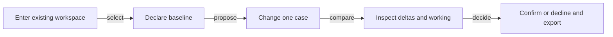
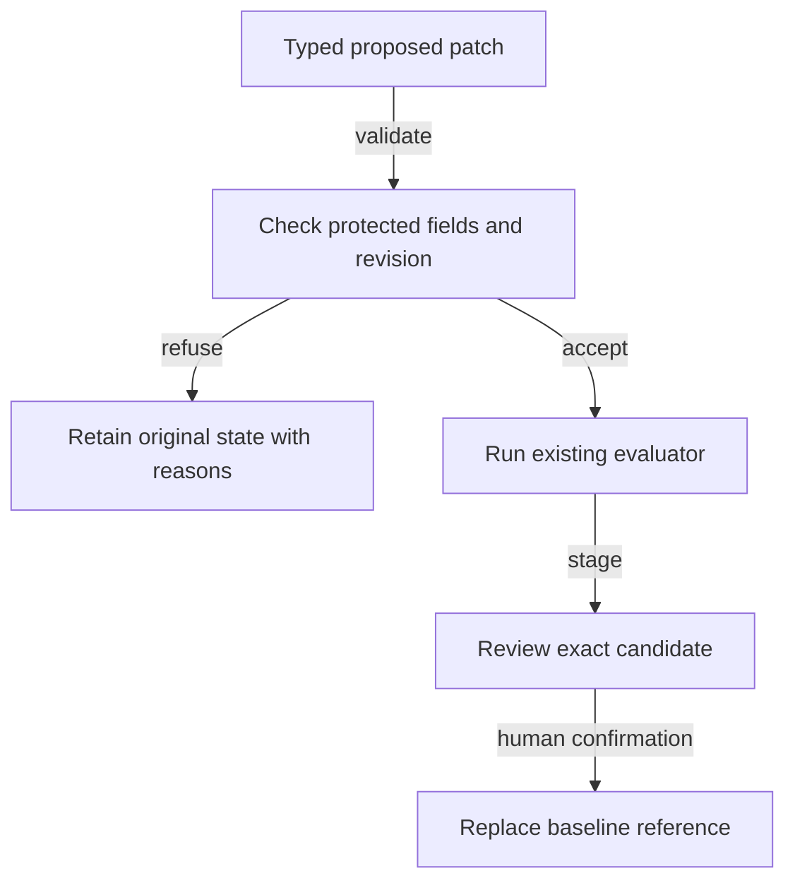
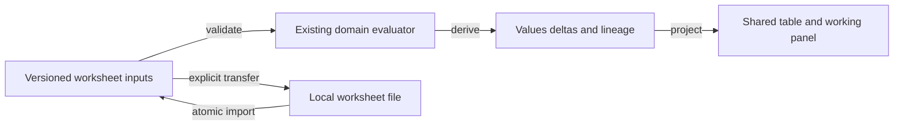
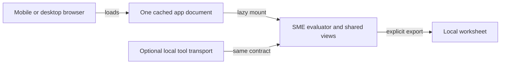

# Reference implementation — Commerce workspace and decision rehearsal

**Join:** `COMMERCE-CONTROL-PLANE-001@0.4.0`. Update the existing shared-shell plan in place. Keep COM-01–08 and ADR-01; extend the same SME workflow with DEC-01–06 and ADR-02. This is the sole editable owner of this increment. Existing commerce, workspace, transfer, housing and first-dollar plans retain their own scopes. No second app, planner, roadmap, capability registry, design system or payment ledger is introduced.

**Revision outcome:** the user's explicit 2026-11-16 IMPLEMENT instruction authorizes the native source changes for the preceding `0.3.0` plan. DEC-01–06 are implemented in the existing SME owners and their bounded decision helper; the implementation checkpoint records checks and remaining acceptance. Shared tokens, package pins, effect owners and four tool identities are retained. Runtime delivery, payment and outreach remain separately gated. Whole-artifact readiness stays conservative until the broader COM acceptance is closed; local implementation evidence is not a deployed product verdict.

**Context:** the pinned source already builds and compares local plans in a shared workspace. **Intent:** an owner can inspect one proposed business change against an explicit baseline, understand the calculation and retain control of protected facts. **Directive:** extend the native scenario contract and workflow, reuse existing shared owners, define bounded acceptance and record live evidence without creating parallel implementations. **Role:** Commerce product function. **Action / SVO:** the product function specifies the native decision rehearsal. **Outcome:** one source-grounded, reviewable joined specification. **Check:** owner source checks, continuity/link review and diagram projection check; product acceptance remains separate.

## Reference implementation — ownership and grounding

All concrete repository, protocol and source identifiers in this artifact describe the selected reference implementation. G1–G7 retain the inspected baseline; the implementation checkpoint below records the successor candidate without rewriting those historical source observations. Paths below resolve in the declared repository at its exact revision. Consumer pins, not sibling checkout HEADs, select runtime bytes. Source inspection, historical receipts and live observations are distinct evidence classes.

| ID / claim | Inspected source and contract | Disposition / implication | Named check / next action |
|---|---|---|---|
| G1: one shared host | Commerce `25f4c8e221ad0a60b63c4fb432b2bbe9d44423d2`; `public/local-first/index.html`, `workspace.js`, `workspace-navigation.js`, `workspace-singleton.js`, `workspace-view-styles.js` | confirmed: existing roles, hash navigation and lazy SME mount; retain COM-01–08 | Existing `test/local-first/workspace-shell-browser.mjs`, `workspace-browser.mjs`; full criteria still open |
| G2: scenario comparison | Same source; `sme-business-pack-core.js`: `invokeSmePackTool`, `TOOL_SCHEMAS`, `comparePlans`; `sme-pack-business-plan.js`: `PACK` v2.3.0 | confirmed: 2–3 rows, same contract/version/currency, entry order, `ranking:null`, `winner:null`, deterministic monthly range arithmetic | `npm run test:unit -- test/shared/sme-business-pack.test.ts`; extend its existing cases for DEC |
| G3: local editing and portability | Same source; `sme-business-pack.js`, `sme-workflow-editor.js`, core `serializeSmeWorksheets` / `readSmeWorksheets` | confirmed: tab-local inputs/evidence, JSON/CSV/Markdown worksheet transfer; no automatic persistence | `test/local-first/sme-comparison-browser.mjs`; verify old worksheet compatibility before version change |
| G4: constrained rehearsal and explanations | Same source, bounded inspection of SME core, pack and editor | absent in inspected scenario contract: explicit baseline identity, protected-field policy and per-output calculation lineage. Existing model output values and evidence coverage are present | New DEC behavior belongs in these owners; absence is a planned gap, not a claim about every repository |
| G5: agent and human routing | Same source; `scripts/sme-business-pack-local.mjs`, `src/invocation/catalog.ts`, `public/local-first/workspace-tools.js` | confirmed: four SME schemas share local evaluator; separate workspace read tools and invocation metadata exist. Remote readiness/parity not established | `check:invocation-surface`, `check:webmcp`, shared tool and browser tests |
| G6: no generic extraction justified | G2/G3 are concrete current consumers of the SME domain contract | confirmed: UI and local tool adapter already call one evaluator; no measured repeated need for another simulation package | Retain domain arithmetic locally; extraction requires two independent consumers and a successor ADR |
| G7: deployed state | Public UI observed 2026-11-16 13:24–13:26 UTC; DOM/source and readiness report `acaae50534077ec0890c6597ed2966c0b8257604` | confirmed live observation; differs from source baseline. It cannot satisfy exact-candidate release acceptance | ER-LIVE below; refresh live identity at any delivery decision |

The prior 0.2.0 snapshot at `2fb00defb2f9a057eaaa659338500c2b6b07aafc` remains history. Its source observation of a same-document SME mount is retained, without inheriting an unrun acceptance verdict. No external code, content, datasets, dependencies or brand assets are adopted by this increment.

### Reference implementation — pinned shared utilities

This is a projection of existing manifests, not a replacement lock. Keep exact manifests/digests authoritative. No new package or cross-repository pin change is part of this authoring task.

| Owner / revision and export | Current consumer / native reuse | Decision and smallest delta | Check / boundary |
|---|---|---|---|
| `agentic-design-system`: shared UI source `9862a2f89b47be3496c72ed9ca28576c992873f4`; registry `0e45c8c420a2f4773a890cbbbf859956c03de73a`; `site/tokens/shared-ui-profile.json` → `site/vendor/shared-ui-profile.css` | Commerce `config/shared-ui-profile.pin.json`, `shared-ui-profile.css`; Base and Graph projections consume the same profile | reuse tokens, focus, typography and semantic states; no palette fork or per-role overrides | `test/local-first/shared-ui-profile.test.mjs`; artifact digest validation; profile projection SHA-256 `5396a794b984c505960807e419f2bfd4504c1006af96533d710d7e433af26063` |
| Same owner, toolbar/panel `7fae5884f7024c1ddd029ef058a3e7758614f73b`; `site/toolbar.css`, `site/floating-panel.css` | `config/toolbar.pin.json`, `floating-panel.pin.json`; existing toolbar and console | reuse current controls/panel for baseline and review; change owner only for a demonstrated shared gap | Existing pinned asset hashes and shared UI tests; no copied component |
| `agentic-base` `67a31bdc121793408becbcd84427d5f7c0b651d0`; `@agentic-base/views-react`, `mountDataView`, `agentic-base/browser-data-view/v1` | `config/agentic-base-data-view.json`; SME workflow/dictionary use current browser artifact and pivot | reuse one multidimensional table, menus, keyboard/row selection and theme slots; add projected fields, not another table | `verifyAgenticBaseDataView` in `scripts/local-first-release/artifact.mjs`; existing SME browser suite; retain Shadow DOM boundary |
| `agentic-graph` `675d0ad10eea5d57fe101c1fb5d4318a804a7ff5`; `canvas/src/features/markdown/ui/dataViewBrowserAdapter.tsx`, `mountDataView` / `mountSequenceGuide` | `config/graph-data-view.json`; existing graph/guide projections | reuse current guide only when it explains the selected decision; no embedded second editor | Artifact hashes; `test/local-first/workspace-graph.test.mjs` and browser suite |
| Same owner, timeline `33a48a80862357f77fad4cda8b90ac717e1a8116`; `mountGanttTimeline` | `config/graph-gantt-timeline.json`, `sme-review-workflow.js` | reuse existing review schedule when applicable; timeline is not a stochastic trading model | Existing review-workflow tests and timeline verifier; lazy load only on its view |
| `agentic-canvas-os` inspected `6913ec5e323b4aa73cc3f5622ea301d278735cca`; `agent-api/src/tool-search.js` re-exports `createToolSearchRuntime` from the OS owner | Commerce uses versioned docs protocol `agentic-canvas-os-docs-routing/v1` through its existing invocation client; no direct Canvas package dependency observed | reuse protocol/discovery owner; retain contract-only transport. A source observation does not mean this export is installed in Commerce | `src/invocation/catalog.ts` digest/limit/refusal checks; any new consumer pin needs export proof first; no sibling source import |
| `agentic-geo` `3256385c98864dbfde7a4e3fd1a1e5901f20f294`; `agentic-geo/core`, `src/core.mjs` | `config/agentic-geo-core.pin.json`, `listing-geo.js`, `agentic-geo-core.mjs`; listing facts | reuse coordinate validation for optional existing location context; do not infer demand, footfall or financial assumptions from a coordinate | `npm run check:geo`; exact 2,037-byte core projection and existing listing-geo tests |
| `agentic-os` `73bf77869d75c60eff687a7e7dbec72ae39be2b2`; `agentic-os/invocation` and existing ADLC CLI | Installed Commerce development tool and invocation serializer; central lifecycle source | reuse parsing/serialization, lane, check and release controls; no second controller, registry or authorization schema | `npm run check`, `check:invocation-surface`; accepted package/lock unchanged |

License evidence stays with the existing owner package/artifact manifests. A dependency change requires fresh license, size, exact revision and compatible export verification. No remote fetch is required for local discovery, arithmetic or reading the prepared plan.

## PRD

### Pain, people and minimum outcome

**0:** source already offers local comparison and shared-shell navigation; buyer pain intensity, frequency, time lost, willingness to pay and repeat use are unvalidated. **1:** one merchant completes a baseline → one changed case → explanation → retained worksheet journey within five minutes, with protected facts intact and unknowns visible. Five observed tasks are the proposed acceptance sample; no such study is claimed.

| Persona / job | User story / value | Evidence |
|---|---|---|
| Owner / operator | As an owner, I want to compare one price, volume or cost change against today's declared inputs so I can explain the difference before acting | hypothesis; native arithmetic and comparison exist |
| Collaborator / agent | As a collaborator, I want proposed changes to respect the owner's protected facts so I can explore within agreed bounds | gap in inspected SME scenario contract; no buyer validation |
| Reviewer | As a reviewer, I want each result traced to dated inputs and a formula so I can distinguish an assumption from an observed fact | existing provenance/evidence fields; calculation lineage proposed |
| Shopper, vendor, administrator | As a workspace user, I want routes, drafts and focus retained as I move between views | COM baseline; complete route acceptance remains open |

| Pain / rank | Hook → break → fix → close | Reuse / minimum value hypothesis |
|---|---|---|
| P1 / first: explain one business change | Enter today's inputs → compare absolute totals without an explicit baseline → show baseline-relative deltas and working → retain a decision worksheet | Existing scenario model, same table and exports; lowest additional domain surface |
| P2 / second: prevent accidental assumption changes | Protect a cost or operating constraint → proposal/import changes it silently → refuse the whole patch with field reasons → owner deliberately revises policy | Existing validation/editor/evaluator, no independent policy engine |
| P3 / third: retain decision context | Switch role, direct link or device → route/context or private facts can be lost → shared shell plus explicit worksheet transfer → review locally | Existing hash routing, tab-local worksheet and shared views; no automatic sync |

All ranks are hypotheses because no validated pain outranks another yet. P1 wins the current technical tie by near-built reuse and the shortest priced-review experiment; revisit upon stronger buyer evidence.

### Journey and verifiable criteria

Journey: open existing SME workspace → select Scenario → supply baseline A and candidate B (optional C) → protect agreed inputs → build locally → inspect deltas, constraints and working → accept or decline a baseline change deliberately → explicitly export/import on another device. Navigation alone never confirms a decision or authorizes commerce effects.

| ID | Given / when / then: one observable end state | Named check and constraint |
|---|---|---|
| COM-01 | Given any role and SME route, when navigating, then one shell/header/navigation/panel/footer stays mounted | `commerce-shell-continuity-check`: existing workspace and shell browser groups; no full document replacement |
| COM-02 | Given direct `#sme`, reload and back/forward, when resolving, then the intended view uses the existing app URL | `commerce-route-history-check`: existing workspace/SME browser cases; no second router |
| COM-03 | Given the same viewport across roles, when comparing, then shared geometry uses one owner | `commerce-shell-singleton-check`: shell browser + shared UI profile tests; role content may differ |
| COM-04 | Given 320/360/390/768/1280 CSS px and 200% text zoom, when using views, then controls are reachable without page overflow | `commerce-responsive-shell-check`: shell/SME browser suite; labelled inner table scrolling allowed |
| COM-05 | Given keyboard, touch and reduced motion, when navigating and closing a panel, then focus, Escape, ARIA and ≥44 px targets hold | `commerce-shell-accessibility-check`: shell browser tests and physical-device review; automated evidence stays bounded |
| COM-06 | Given slow, failed or superseded work, when a route changes, then late results cannot replace active content or erase input | `commerce-route-race-check`: existing SME/workspace generation and failure tests |
| COM-07 | Given a warmed cache without network, when navigating local views, then they remain usable and runtime facts show stale/unknown | `commerce-shell-offline-check`: owner offline/browser group; open-tab arithmetic alone is insufficient |
| COM-08 | Given a role/pack action on any surface, when invoked, then existing capability and authority boundaries remain enforced | `commerce-capability-boundary-check`: invocation/WebMCP and workspace-tool tests; navigation grants no effect |
| DEC-01 | Given compatible baseline A and B/C, when comparing, then declared monthly outputs include traceable candidate-minus-baseline deltas | Extend `test/shared/sme-business-pack.test.ts` and SME browser suite; preserve row order, unknowns, currency and no-winner contract |
| DEC-02 | Given protected fields or declared limits, when a human/agent/import patch violates them, then all changes are refused with field-specific reasons | Extend same evaluator/editor tests: locked, out-of-range, stale-policy, malformed and mixed-validity patches leave original bytes unchanged |
| DEC-03 | Given a displayed output, when opening its working, then formula, operand values/ranges, units, period, provenance/date and unknown dependencies reconcile to that output | Extend core tests with independent arithmetic fixtures; no second formula implementation in the view |
| DEC-04 | Given a built candidate, when requesting baseline replacement, then only explicit current owner confirmation changes the baseline | Extend same browser suite: approve, decline, stale-revision and repeated-request cases; agents may prepare only |
| DEC-05 | Given a versioned worksheet and two devices, when exporting/importing, then accepted baseline, policy, evidence and candidate meaning survive validation | Extend existing serializer/import corpus and offline/mobile browser suite; atomic refusal, size limits and old worksheet behavior preserved |
| DEC-06 | Given the same admitted build/compare request, when using UI, local tool adapter or supported WebMCP, then semantic output and refusal reasons agree | Extend existing shared-tool and browser tests; canonical output compared excluding documented timestamps; cancellation and unsupported modes explicit |

**Must:** COM-01–08 retained; DEC-01–06 as the smallest dependency-closed enhancement, with owner confirmation and old worksheet compatibility. **Should:** optional local task timing and compact input-difference summary. **Could:** explicit user-authored sensitivity grid after baseline acceptance. **Won't (this increment):** stochastic demand/queue simulation, wage/tax libraries, industry defaults, live market feeds, autonomous baseline promotion, optimization/winner selection, auto-sync, new storage, accounts, remote telemetry, paid models/services or new checkout/payment behavior.

### Metrics, market and economics

| Metric | Baseline | Proposed target / observation window |
|---|---|---|
| First useful comparison | Source supports comparison; timed buyer baseline unknown | ≤5 minutes and ≤6 deliberate stages for five observed owner tasks in first pilot window |
| Explainability / input safety | Per-output lineage and protected policy absent in bounded inspection | All displayed deltas reconcile; zero protected-field changes in accepted test corpus |
| Integration friction | UI and local adapter already share evaluator; savings unknown | Record failed/repeated actions, implementation minutes and support minutes for the same journey before/after |
| Demand / cash | No buyer interviews or new collection evidence in this task | Proposed five interviews and three priced walkthroughs over seven days; stop condition in GTM |
| Serving resources | No model needed for local planning | 0 inference tokens, $0 incremental external spend, existing bounded arithmetic and cached assets |

Target segment hypothesis: independent merchants or small service operators who already have operating inputs and must explain a proposed change. The buyer may be the owner or an implementation partner; geography and industry do not select defaults. Existing spreadsheets/manual notes and doing nothing are the principal alternatives to test.

Top-down sizing = verified eligible operators in a selected geography × observed annual price. Bottom-up sizing = reachable qualified prospects × observed paid conversion × collected price, constrained by onboarding/support capacity. Those inputs and reconciliation are unknown; no population, monetary TAM/SAM/SOM, growth or adoption claim is made. Review input rights, customer-data handling, local commercial obligations and offer terms before any external pilot; this specification supplies no legal or financial advice.

## TAD

### Single host and decision contract

TAD consumes PRD `0.4.0`. Extend the existing SME mode, schema, evaluator, workflow editor and worksheet serializer; the one shared shell remains mounted. The existing 2–3-slot comparison is the canonical row set. A baseline is a reference to a row at a revision, not a copy of every row in another store. The calculation result remains a derived report; no payment, order or published listing follows from it.

| Element / criterion | Native owner | Smallest planned delta / recovery |
|---|---|---|
| T1 shell / COM-01–07 | Existing document, navigation, generation and view-style owners | Fix only evidenced continuity gaps; preserve hash/history/focus semantics and local input rules |
| T2 economics / DEC-01,03 | `sme-business-pack-core.js`, existing monthly model | Add baseline-relative projection and formula descriptors beside the current arithmetic; output lineage references current operands, never a second calculation engine |
| T3 policy / DEC-02,04 | Same domain evaluator, `sme-decision-contract.js` and `sme-workflow-editor.js` | Validate one bounded proposed patch against expected row/policy revision before atomic commit. Confirmation binds exact proposed inputs and policy; stale/unknown is refused |
| T4 view / DEC-01–04 | `sme-business-pack.js` with current shared table/panel | Project deltas and working; controls dispatch same domain action as supported tools; no separate dashboard/state store |
| T5 portability / DEC-05 | Core serializer/import and current worksheet schema | Version only if required; legacy input is reviewed with no silently inferred baseline/protection. Unknown future versions fail before mutation |
| T6 adapters / COM-08,DEC-06 | Existing SME schemas/local adapter/WebMCP; invocation client | Update owner schema once, project supported actions only; no second registry or agent-specific financial logic |
| T7 status / COM-07,08 | Existing environment observation and toolbar status owner | ER-LIVE sampled a startup status transition; verify its timing at that owner before proposing a repair. Do not label all capabilities healthy from one local module being usable |

**Math:** reuse declared monthly calculations: revenue = unit price × units; contribution = revenue − variable unit cost × units; operating result = contribution − fixed cost − payroll. Retain current break-even and runway status distinctions. Candidate delta = candidate output − baseline output only for comparable contract/version/currency/units/period. For ranges, use existing interval arithmetic: difference bounds `[candidate.low − baseline.high, candidate.high − baseline.low]`; identical inputs share the same expression and yield zero change. Non-identical interval deltas are conservative bounds, not a probability, confidence interval or forecast. Missing operands produce explicit unknown dependencies, never zero.

**Policy:** proposed baseline reference, protected field keys and optional bounds live in the existing worksheet envelope at its new reviewed version, if needed. Typed input differences are evaluated against current protected values before any write. Policy authoring/unlocking and baseline acceptance belong to explicit human actions; tool annotations alone provide no enforcement. Persisted offer facts, secrets and financial authority remain outside this planning envelope.

**Safety and races:** retain pack/contract/comparison generations, response bounds, cancellation and route-exit clearing. Pending proposals bind expected row and policy revisions; reject after edits, contract switches or baseline replacement. Import parses and validates all rows before swapping tab-local state. Reject prototype keys, unexpected fields, non-finite/oversized values, invalid dates, mixed currencies and incompatible contracts. Render user text as text. Retain existing CSP and offline/service-worker boundaries; no telemetry or remote upload of inputs.

**Limits:** existing tool request ≤32,768 B, response ≤65,536 B, 2–3 comparison rows and ≤40 evidence records per input set remain upper bounds. Reuse current serializer limits rather than inventing a larger transfer contract. Browser-safe utilities carry no filesystem, secret, provider SDK or effect authority. A generic shared extraction needs an ADR and two real independent consumers; UI plus its adapter alone do not justify a new package.

### Reference implementation — invocation projection

This table references the existing Invocation Register and owning schema; it introduces no names. `/` is a command, `@` a binding and `#` semantic scope. Discovery is metadata and creates no authority.

| Surface | Existing identity / owner | Current mode / enhancement boundary |
|---|---|---|
| Human UI | `#sme`, `#sme-workflow`, `#sme-dictionary`; existing SME view | build/compare local inputs; add protected proposal review in the same view |
| Local MCP | `npm run sme:local`; `pack.list`, `pack.protocol`, `business.plan.build`, `business.plan.compare` | deterministic discovery/build/compare; add compatible fields only after schema/version review; baseline commit unsupported |
| WebMCP | Same `TOOL_SCHEMAS` and `invokeSmePackTool` in active SME view | browser support conditional; fallback is normal UI. Test registration/cancellation/route disposal; unavailable API is explicit |
| HTTP | Existing `/services/sme-business-pack` adapter | server parity and availability unverified here; explicit request snapshots only, no access to another tab's private state |
| `/`, `@`, `#` | `src/invocation/catalog.ts`, `agentic-os/invocation`, existing docs gateway | read-only resolution to existing capability IDs; no invented scenario aliases; new aliases deferred until owner declaration/check |
| Skills / commands | Existing entrypoints consume the same owner schemas | orchestrate supported prepare/read calls only; no baseline approval, publishing or money authority |
| Geo / Graph context | Existing listing and graph adapters | optional contextual read; neither selects a financial assumption nor authorizes a decision |

Build/release dependencies stay acyclic: portable contracts/tokens → domain evaluator and owner exports → exact consumer pins → transport adapters → views. Versioned request/reply between services is not permission for cyclic package imports. No source import from a sibling checkout is allowed.

### Applicable flows and topology

Each feature group classifies all five canonical flow types. All are applicable here: user journey (owner comparison), workflow (patch/review), data (worksheet/report), orchestration (existing bounded checks and human gate), topology (local browser plus optional read-only adapter). DEC features use D1–D5 with T2–T6; COM features use the same host path with T1/T7. No new agent orchestration is required.

**D1 — User journey, conceptual, v2:** an owner reviews a local change.

**D2 — Workflow, conceptual, v2:** invalid or stale proposals leave state intact.

**D3 — Data flow, conceptual, v2:** one domain model produces every projection.

**D4 — Orchestration, conceptual, v2:** source and delivery require different evidence.

**D5 — Topology, conceptual, v2:** local planning needs no remote runtime.

| Diagram | Primary surface / ingest | Expected nodes / edges / clusters | Projection check |
|---|---|---|---|
| D1 | flowchart / fenced body | 5 / 4 / 0 | shared `check-diagram-canvas-render.mjs` |
| D2 | flowchart / fenced body | 6 / 5 / 0 | same checker |
| D3 | flowchart / fenced body | 5 / 5 / 0 | same checker |
| D4 | flowchart / fenced body | 5 / 4 / 0 | same checker |
| D5 | flowchart / fenced body | 5 / 4 / 0 | same checker |

Topology: the browser owns ephemeral private inputs; the explicit worksheet is user-controlled storage; the edge supplies existing immutable assets/configuration, not remote scenario persistence; optional local adapters evaluate supplied snapshots. A baseline confirmation is a local owner gate. No diagram arrow creates a deploy, network-write or payment grant.

### Native design adoption and resource bounds

| Concern | Reused owner | Acceptance / gap |
|---|---|---|
| Identity/assets | Existing document and native assets | No new illustrations, brand or asset dependency; existing rights unchanged |
| Settings/preferences | Existing navigation and view state | No new global preference store; policy belongs to worksheet, not theme settings |
| Tokens/typography/icons | Pinned design profile, toolbar/panel and shared artifacts | Existing source digests plus contrast, text zoom and labels; no font download |
| Table/editor | Existing Base table, pivot and SME editor | One active editor; keyboard/touch/focus and route-exit tests |
| Status/evidence | Existing status and environment owners | Show local computation separately from runtime availability; ER-LIVE startup timing unverified |

Authoring sprint: ETA/cap 30 active minutes, one existing Markdown file, ≤60,000 B total, <600 lines, zero runtime modules/dependencies/pin changes, zero added always-load bytes, 0 inference/serving tokens, $0 new external spend. Session authoring tokens/time are reported only if measured; no fabricated usage receipt.

Proposed implementation, after authorization: two bounded 90-minute slices, ≤10 existing runtime/contract paths plus their owner tests, ≤60 kB total incremental authored browser bytes, zero new runtime modules preferred, every authored file <600 lines and every chunk <500,000 B. Current core is 508 lines and main view 556; extend/factor existing owner modules before reaching the cap. Reuse an existing module, never evade the limit by adding another evaluator. Refresh scope/budgets on drift. Keep explanations/review assets lazy beyond active workspace; no new always-load instruction.

## ADR-01 — Retain the single mounted shell

**Decision retained:** preserve the existing document/hash router/lazy SME mount and shared panel. Source implementation exists; complete COM-01–08 acceptance remains open. Alternatives: a separate document loses continuity; a new path router adds unneeded host work; a framework rebuild duplicates near-built capability. Recover by reverting only an evidenced route regression and checking direct URLs/history/focus; preserve drafts. Revisit only if the current route cannot meet acceptance.

## ADR-02 — Extend deterministic scenarios and explicit owner review

**Status:** proposed; binds PRD/TAD `0.4.0`. Constraint gate: $0 external spend, no new data service, no model dependency, protected facts, deterministic results, portable worksheets and one owner. Existing deterministic comparison meets those constraints. A contract-only adapter is acceptable for transport differences but cannot contain calculation or authority logic.

| Alternative | Argument / feasibility | Outranking and consequence |
|---|---|---|
| Direct native reuse plus owner extensions | Existing arithmetic, 2–3 rows, UI/tool schemas and exports; missing deltas/policy/lineage stay with owner | selected: smallest gap and no runtime service; must version compatibility deliberately |
| Keep current absolute comparisons | Zero implementation cost and a viable fallback | second: no new value claim; select if five-task experiment shows no comparison pain |
| Add independent simulator/package | More features, but new state/formulas, invalid domain assumptions and bundle/support cost | rejected for this increment; requires repeated evidenced need and successor ADR |
| Copy UI logic into tool adapters | Quick prototype but inconsistent refusals and duplicate ownership | rejected; all surfaces call existing evaluator |
| Add stochastic operational model | Needs calibrated data, distributions and domain validation unavailable here | deferred; no seeds, percentile bands or queue/waste estimates are implied by interval ranges |

Policy and explanation metadata remain in the domain owner; generic encoding/grammar remains in shared utilities. Before replacement or schema promotion, test accepted/refused inputs, canonical bytes/digests, errors, bounds, cancellation, revision races, deterministic outputs and idempotent preparation. Remove superseded local behavior in the same accepted replacement; a compatibility shim needs actual callers, a retirement trigger and a check.

Rollback restores exact prior source/pins and disables the new optional projection while preserving user-exported worksheets. Reject unsupported future versions without data mutation; baseline rollback never replays a payment or changes a live offer. Revisit on failed compatibility, repeated >5-minute buyer task, or a measured independent second consumer.

Deployment TCO comparison: existing cached local browser has $0 incremental infrastructure/model target and unknown labor/support; an optional self-hosted adapter uses existing device resources with allocation unknown; hosted shared execution has unknown quota/headroom and is not selected. No 12-month TCO or savings figure is evidenced. Any new provider effect requires current hard-$0/deny-at-quota proof; unknown cost blocks that effect only.

## MVP

### Accepted slice, checks and readiness

MVP consumes COM-01–08, DEC-01–06, T1–T7 and ADR-01/02 at `0.4.0`. It is one enhancement inside the current SME workspace. Existing source/liveness evidence reduces discovery work; it does not satisfy the proposed enhancement or grant baseline changes.

| Criteria | Current evidence | Completion boundary |
|---|---|---|
| COM-01–08 | G1 source and ER-LIVE bounded navigation/layout; full matrix not executed here | retain existing owner browser groups; all route/focus/race/offline/device cases required for closure |
| DEC-01–06 | G2/G3 provide reusable foundation; G4 identifies gaps | candidate implementation present; 26 unit/HTTP/MCP tests and focused desktop/mobile/offline browser checks cover DEC behavior. The full source gate and broader COM matrix remain separate evidence |
| Authoring | One joined owner, exact grounding/pins, addressed five roles and flow source | source checks/projection/link/continuity evidence; no product rung advancement |

**Traceability:** COM → T1/T6/T7 → ADR-01 → existing shell/workspace/tool checks; DEC-01/03 → T2/T4 → ADR-02 → SME core/browser; DEC-02/04 → T3/T4 → ADR-02 → protected patch/confirmation cases; DEC-05 → T5 → ADR-02 → import/export corpus; DEC-06 → T6 → ADR-02 → adapter parity/refusal corpus. The implementation extends these existing suites; the focused decision browser module is called by the existing SME browser owner, without a parallel check controller. Independent owner runners judge outcomes; author assertions do not satisfy VCCs.

**Demo skeleton:** Hook: owner asks what one price change does → Probe: declare baseline and one candidate, protecting a cost → Reveal = DEC-01/03 reconcile the result and its working → challenge a protected edit (DEC-02 refusal) → Close: decline/confirm deliberately and export the worksheet. Proposed ≤3-minute demo plus five ≤5-minute tasks; not yet timed. Core functionality, theme/innovation, technical integration and usefulness/agent experience are all **unassessed** for this enhancement; require source-bound checks and buyer comparison before ratings.

### Roadmap and bounded RAO steps

One product roadmap under this join; the existing first-dollar record alone owns payment and validation learnings.

| Step / phase | Role, one action and observable outcome | Prerequisite / exit | Bounds / stop / recovery |
|---|---|---|---|
| R0 / specification | Product function specifies one owner-grounded increment → this artifact | User authoring request; continuity, links, projection and affected checks | 30 min, one file ≤60 kB, zero runtime delta; retain exact draft if release authority unavailable |
| R1 / contract | Domain maintainer extends current scenario/worksheet contract → compatible baseline/policy/lineage | Implementation authorization; DEC contract and legacy-corpus checks | First 90 min slice with R2; ≤60 kB total delta, no added service; stop before schema ambiguity or file cap |
| R2 / projection | UI maintainer projects the accepted contract in existing table/editor → one coherent view | R1 export/schema first; DEC unit/browser acceptance | Same first slice; zero second store/router; revert optional fields on incompatibility |
| R3 / verification | Existing evaluator runners verify the exact candidate → evidence for COM/DEC | R1/R2; full affected negative/race/offline/mobile/parity cases | Second 90 min slice; ≤3 correction cycles, stop after two without blocker reduction |
| R4 / delivery | Product release owner promotes exact protected candidate → separate Dev/Prod/rollback receipts | Source integration, provider cost proof and explicit effect authority | External wait: recheck on exact approval/receipt; no deployment ETA or assumed grant |
| R5 / learning | GTM function records priced pilot outcome → successor context in existing learning owner | Usable accepted slice and contact/payment authority | Proposed seven-day observation window; stop/pivot below; no outreach in this task |

Source order is owner contract/checks → compatible export/version → exact pin/lock if changed → adapter/view projection → affected checks. Any upstream shared-owner change follows that dependency order in its own scope; no opportunistic dependency upgrades.

## GTM

GTM consumes PRD/TAD/ADR/MVP `0.4.0`; it creates no new feature requirement. Proposed offer: an owner-guided setup and explanation of one existing baseline/candidate worksheet. The existing first-dollar plan remains the only payment/learning record. No buyer, paid price, payment mechanism outcome, recognized revenue or collection is evidenced by this authoring task.

| Stream / rank | Constraints → argument → decision | Evidence / next experiment |
|---|---|---|
| 1 / assisted setup and decision review | Reuses current local workflow; no new hosting or provider. Shortest credible path if owner pain exists | hypothesis; five interviews then three priced walkthroughs. A US$1-equivalent local-currency collection is a validation threshold, not a selected price or revenue claim |
| 2 / recurring support | Needs repeated use and measured support load; greater trust/retention burden | deferred until two repeat-use observations and positive contribution evidence |
| 3 / hosted subscription or transaction take-rate | Needs separately authorized reliable serving/settlement and verified zero-cost bounds | Won't this increment; not proven by a static demo or tool registration |

**Experiment:** after authorized contact, ask five qualified owners about their latest real comparison, workaround, frequency and time cost; show the same priced offer to three qualified walkthrough participants over seven days. Log actual time-to-result, explanation comprehension, protected-edit refusal, explicit offer acceptance/decline, support minutes and repeat request. Price comes from willingness-to-pay evidence, not this plan. Success hypothesis: ≥3/5 report the same recent pain, ≥2/3 complete the task, and ≥1 deliberately purchases a permitted fulfilled service. Mechanism proof and demand validation stay separate; a synthetic test payment proves neither. Stop/pivot after 0/5 recent pain or 0/3 offer acceptance; retain the current free comparison and record the successor rather than add scope. Unreachable buyers are an external blocker, rechecked on a qualified prospect, not an inferred failure or an ETA.

Contribution = collected service price − payment fees − delivery labor − allocated serving/hosting − support/refunds. Record recognized revenue separately from cash collected, tax and reversals. Price, conversion, labor rate, CAC, LTV, retention and total hosting allocation are unknown. Income statement, cash flow and balance sheet are not produced from invented inputs; future finance projections must reconcile collections, working capital and closing cash at this join. Base/downside/upside remain input-driven scenarios, not a forecast: downside includes zero conversion; upside is capped by measured delivery capacity. $0 bootstrap capital, no funding ask and no claim of break-even/runway.

Operations: existing product owner triages route, import, input-policy, arithmetic and readiness incidents; retain explicit customer consent and redacted evidence. No private worksheet telemetry. Recovery restores known-good source/pins and preserves exportable facts. New customer obligations, data retention or regulated use require a scoped decision before that dependent pilot. Pitch deck, full business plan and financial model are deferred until an actual audience decision needs sourced projections.

## C01–C16 coverage

Join `COMMERCE-CONTROL-PLANE-001@0.4.0`, as of 2026-11-16. A covered row means the specification addresses it, not that implementation or the business is validated.

| Domain | Disposition / section | Evidence or gap / accountable function / revisit |
|---|---|---|
| C01 purpose/customer/pain | covered / PRD | Hypotheses and source gaps; Product; five-task/pain experiment |
| C02 market/timing | covered / PRD | Two sizing formulae, inputs unknown; Product; qualified segment evidence |
| C03 offer/alternatives | covered / ADR/GTM | Native/no-change alternatives and priced-test plan; Product; offer acceptance |
| C04 product/experience | covered / PRD | COM/DEC VCCs, mobile/accessibility and demo; UX; criterion acceptance |
| C05 architecture/data | covered / TAD | One domain/state owner, exact pins and flows; Architecture; contract/schema change |
| C06 quality/security/AI | covered / TAD | Negative/race/privacy cases, zero inference; Security; affected checks |
| C07 decisions/tradeoffs | covered / ADR | Native extension selected; stochastic model deferred; Architecture; failed constraints |
| C08 smallest validated slice | covered / MVP | Dependency-closed target; enhancement acceptance open; Product; R3 evidence |
| C09 acquisition/retention | covered / GTM | Existing learning owner, bounded pilot and repeat-use trigger; GTM; authorized observations |
| C10 operations | covered / TAD/GTM | Incident/recovery and live readiness gap; Operations; next exact live readback |
| C11 organization/obligations | covered / PRD/GTM | One accountable function, private inputs and scoped gates; Product; external pilot/data change |
| C12 financial viability | covered / GTM | Contribution formula, price/cost/cash unknown; Finance; actual receipts |
| C13 capital/milestones | covered / MVP/GTM | $0 bootstrap, no ask, bounded phase exits; Product; verified quota/capacity failure |
| C14 ADLC execution | covered / release boundary | Exact lane/candidate, checks and per-effect receipts; ADLC owner; publication/integration |
| C15 audience projections | deferred / GTM | No audience decision or sourced finance; Product; qualified audience request |
| C16 learning/successor | covered / GTM | Thresholds, stop/pivot and existing learning owner; Product; pilot result or material assumption drift |

Coverage: 16/16 dispositioned, 15 addressed, one deferred. Full authoring-rule coverage ratio and independent conformance verdict are not computed by this table. No complete guideline certification is claimed.

## Live UI evidence and remaining findings

**ER-LIVE, reference implementation:** public `https://airvio.co/agentic-commerce-os/#sme`, isolated anonymous browser, 2026-11-16 13:24–13:33 UTC (21:24–21:33 Singapore). Inspected accessibility tree, visible screenshot and DOM/readiness JSON; performed only navigation and local illustrative-input actions. No hosted payment/session submission or customer-data write was performed. Screenshot was visually inspected inline; filesystem screenshot export was refused by the browser tool, so no saved-image receipt is claimed.

| Observation / check | Recorded result | Scope and limit |
|---|---|---|
| Desktop entry / local Scenario action, 1510×905 | PASS sampled action: `#sme`, local protocol v2.3.0, Scenario selection, illustrative inputs, “Local scenario plan built”; no page-level overflow; local storage keys empty | One row built; no 2–3-row end-to-end comparison or DEC behavior claimed |
| Mobile entry / local build, 390×844 | PASS sampled action: visible shared toolbar, plan mode/contract form, local-computation disclosure; illustrative Buy/Build plan built; no page overflow | Emulated touch/mobile screenshot, not physical-device, 200%-zoom or complete COM-04/05 acceptance |
| Responsive/state transition | Changing browser emulation returned the plan to its initial local state | Cause unverified: possible tool reload or app lifecycle. Do not call this proven responsive-state preservation or loss; owner browser suite must distinguish them |
| Offline attempt | INCONCLUSIVE: emulation changed page identity/state, old element refs expired, and readback still reported `navigator.onLine:true` | No offline/reload acceptance credited; rerun controlled owner offline suite |
| Exact public identity | DOM and readiness source `acaae50534077ec0890c6597ed2966c0b8257604`; Worker version `51c2d0b1-e420-49e9-bec9-a08decd6c31d` | Different from inspected local `25f4c8e…`; source check and live sample cannot be joined into candidate delivery proof |
| Readiness / status consistency | `/readyz` HTTP 503: `ok:false`, configured-capabilities, fulfillment unavailable; initial toolbar showed “Service ready”, final 1280×900 screenshot/readback at 13:33 UTC showed “Service unavailable” | Final status agrees. Startup duration/cause unverified; do not infer a persistent bug. Local arithmetic is distinct from fulfillment; test startup before repair |
| Payment configuration | Readiness reported checkout live / `realMoney:true` | Configuration observation only, not successful transaction, revenue, demand or permission to exercise checkout |

Open acceptance gaps: Product owns source acceptance for the implemented DEC-01–06 through R3; QA owns exact-candidate evidence and the broader COM physical-device matrix; Operations owns investigation of T7 startup status timing. These are product/evidence gaps, not self-issued conformance verdicts or satisfied criteria. Independent full alignment is still required before implementation baseline promotion. If that review raises a conformance finding, record the shared six fields: Finding Type, Severity, exact Rule ID, artifact reference, bounded verbatim evidence and one remediation.

## ADLC, release boundary and handoff

Native START readmitted the existing open, unqueued `agent/device-0232231d4a19/commerce-native-decision-plan` lane at `37778153321b48a82480720b4880a519e09a62e5`, expanding exact reservations for the authorized implementation and tests. The user-selected plan and source history are retained in the same [PR #280](https://github.com/huijoohwee/agentic-commerce-os/pull/280); canonical remains read-only. The user grant covers implementation and verification, not customer publication, a new hosting service, payments, outreach or Production promotion.

This increment now changes runtime artifacts: the core, view, editor, stylesheet and one domain helper, plus native asset allowlists/service-worker caching and two existing tool adapters. It no longer qualifies for the preceding documentation-only no-deploy disposition. Source publication, protected integration, runtime delivery and recovery each require their own authority and receipt. Follow central START/ADLC/RELEASE and the product's `docs/production-runtime.md` / `docs/deploy-boundary-register.json`; do not infer delivery from source tests or an open PR.

The helper is a bounded split within the current domain owner: input policy validation, formula metadata, baseline proposal binding and projections; all arithmetic stays in the existing evaluator. This single new module is justified by the core/view file budgets and is not a parallel evaluator, state store or registry. Module execution remains lazy through the existing SME mount; its small cache entry is included with the existing offline core so a primed workspace can enter SME offline. Shared package revisions, UI profiles and release authorities do not change.

Any runtime release requires the exact protected source and artifact, current hard-$0/quota-denial proof, Dev readback, separately authorized Production promotion, route/asset/version acceptance and a retained rollback predecessor/rehearsal. The v3 decision worksheet preserves files and accepted v2 import behavior; old readers explicitly refuse v3, so retain exported files and a compatible new reader during rollback rather than discard protection metadata. Reverting source never reverses a payment or publishes a local baseline.

Handoff includes the scoped diff, named checks, actual results, exact candidate/PR receipts, resource measurements and unresolved acceptance. R1/R2 are implemented; R3 requires the clean exact-candidate source gate and existing broad browser suite; R4 and R5 remain separately gated delivery and learning. External waits retain blocker, condition and event recheck, not an ETA.

## Evidence and references

Authoring owner: [guidelines](https://github.com/huijoohwee/huijoohwee.github.io/blob/99ea1f49211361528256045719b54f1634eee41a/guidelines/prd-tad-adr-mvp-gtm-guidelines.md) 3.5.0; [templates](https://github.com/huijoohwee/huijoohwee.github.io/blob/99ea1f49211361528256045719b54f1634eee41a/guidelines/prd-tad-adr-mvp-gtm-templates.md) 1.6.0. Exact content digests are in frontmatter. Central lifecycle source: `agentic-os@73bf77869d75c60eff687a7e7dbec72ae39be2b2`, `guides/SYSTEM-PROMPT-RUNTIME.md`, `docs/START-WORKFLOW.md`, `docs/adlc-guidelines.md`, `docs/RELEASE-WORKFLOW.md` and `guides/DEPLOY-WORKFLOW.md`.

Existing product owners: [edge commerce](prd-tad-adr-mvp-gtm-edge-commerce-agent.md), [workspaces](prd-tad-adr-mvp-gtm-commerce-workspaces.md), [runtime](production-runtime.md), [composition](commerce-graph-runtime.md), [first-dollar learning](prd-tad-adr-mvp-gtm-20260909T1320Z-solopreneur-mvp-gtm.md), [native utility reuse](prd-tad-adr-mvp-gtm-native-commerce-shared-utils.md). Follow each record's own revision and scope; historical evidence never silently upgrades this increment.

## Implementation checkpoint — reference implementation

**Authorization and join:** implementation of `COMMERCE-CONTROL-PLANE-001@0.3.0` was explicitly requested on 2026-11-16; this coherent `0.4.0` successor records the resulting design and source. Earlier documentation-only candidates and their green source check remain historical in PR #280. This candidate adds product code and requires its own source proof.

| Criterion / owner | Implemented behavior / current evidence |
|---|---|
| DEC-01 / existing core and shared table | Optional explicit baseline; positive/negative candidate-minus-baseline interval deltas, zero for shared identical expressions, unknown/incomparable states, row order and no-winner semantics retained. Unit fixtures independently reconcile monthly arithmetic. |
| DEC-02 / domain policy and existing editor | Atomic protected/bounded patch refusal, row/policy revision checks, explicit owner lock/unlock and field-specific human messages. Imported policy cannot silently replace a current policy; rejected multi-field imports retain all facts. |
| DEC-03 / current evaluator and editor | Working projects actual model results with formula descriptors, operand values/ranges, units, period, dates/provenance and missing dependencies. No second calculation implementation is introduced. |
| DEC-04 / current local row state | Owner requests then confirms/declines an exact baseline proposal. Input/evidence/policy changes make a proposal stale; replay is refused and no tool can commit a baseline. |
| DEC-05 / existing serializer/importer | Optional `sme-business-plan/worksheet/v3` carries policy, baseline and row revision in JSON/CSV/Markdown; v2 remains accepted without inventing a policy. Canonical policy equality, mixed/future-version refusal and atomic local import are checked. |
| DEC-06 / existing four tool identities | Same schemas/evaluator across UI, WebMCP wiring, real HTTP/MCP handler and actual stdio MCP adapter. MCP retains full JSON text when it fits, or the complete `structuredContent` with compact text when JSON escaping would exceed the unchanged response budget. Consumers use structured content when present, otherwise decode the JSON text; WebMCP keeps its existing full JSON text contract. |

**Observed local checks:** `npm run test:unit -- test/shared/sme-business-pack.test.ts` passes 26 tests including negative inputs, revisions, independent values, interval identity, worksheet formats, mismatched periods and real MCP payload/refusal cases. `npm run typecheck`, `check:webmcp` (6 assertions), `check:invocation-surface` (12 assertions), `check:authored-limits` (622 files), `bundle:production` and `git diff --check` passed. Dry-run production chunks remain below 500,000 B; observed maximum was 489,849 B before the final small adapter encoding adjustment, to be rechecked by the final source gate. No provider deployment was performed.

The focused `test/local-first/sme-decision-browser.mjs` exercises explicit/declined/stale baseline review, protected and bounded edits, atomic refusal, WebMCP contract-fixture parity, a second browser page, offline reload/import, 320/360/390/768/1280 widths and 200% text zoom. Native WebMCP availability and physical-device acceptance are not claimed. Its desktop/mobile images and JSON proof are generated by the existing browser owner in the existing evidence output directory. The local preview uses the existing local-first development profile. Replacing its staged asset directory during hot reload produced an app-entry 503; verification restarts that owned preview on its fresh local origin instead of mistaking this for a service-worker verdict.

**Budgets:** nine existing runtime/contract paths plus one new pure domain module, approximately 27.5 kB net runtime source growth before final measurement; no dependency, package-pin, hosted-resource or always-load instruction change. All authored files remain below 600 lines, including the existing 599-line browser owner which delegates the new bounded scenarios. Serving inference remains zero; session tokens, labor cost and attributable provider cost are unknown. Source checks grant no effect authority.

Initial broad execution passed 287/288 tests before the clean-source prerequisite. Subsequent clean source passed 288/288 local-first tests and the complete owner browser suite. The local aggregate stopped at its separate Podman workerd-override prerequisite; protected Linux Integration Gate 43894152622 passed for `4a9dc17ffe8b499a73ec889155f95c6f19ffb261`. These observations retain their separate check scopes.

## Verified decision-slice release — 2026-11-16 UTC

The explicit user instruction “merge, deploy, promote” authorized native release. [PR #280](https://github.com/huijoohwee/agentic-commerce-os/pull/280) merged as `b545861f6c0f74cd516f362cec26c702913e5c64`. Native reader run **43904555981** and live promotion **43906323414** succeeded with all 92 source entries identical. Production Worker **43619020-6186-4c1d-8578-a525fe7add42** reports that source and fulfillment ready. [Bound receipts](reports/commerce-decision-release-20261116.json) distinguish source, fixture, reader, promotion, runtime, cost and recovery proof.

| Feature | Delivered evidence |
| --- | --- |
| DEC-01 baseline and deltas | Explicit B baseline; independent monthly deltas; no winner |
| DEC-02 owner constraints | Protected edits and atomic invalid imports refused |
| DEC-03 calculation working | Delivered formulas, units and missing-evidence states |
| DEC-04 guarded review | Declined and stale confirmations preserve the baseline |
| DEC-05 portable worksheets | v3 export/import and mobile offline reload passed |
| DEC-06 shared transports | Three-row HTTP/MCP parity and refusal reasons passed; four existing tools |

Delivered desktop/mobile inspection, widths 320–1280, 200% text zoom, zero private UI writes, enforced CSP and the exact decision asset digest passed. WebMCP uses a contract fixture; native browser support and physical-device acceptance remain unclaimed. Workers Free $0, current headroom and fail-closed quota routing were reobserved. Retain same-source reader **6a70818b-1a0d-44f1-bb53-e2db031f950d** and v3 files; the native live-profile controller records no new actual-job rollback rehearsal or payment.

This observation-only checkpoint preserves the `0.4.0` requirements and conservative whole-artifact rungs. The next product action is one consenting usability trial; WTP and revenue remain unverified. The immutable workspace Context is prepared locally; native publication is blocked by its missing repository trust anchor. Metadata-only receipt paths are excluded from the deployed artifact and require no redeployment.
