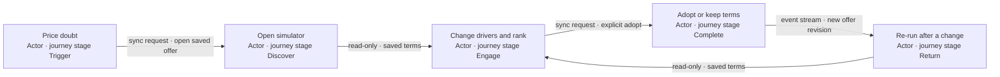
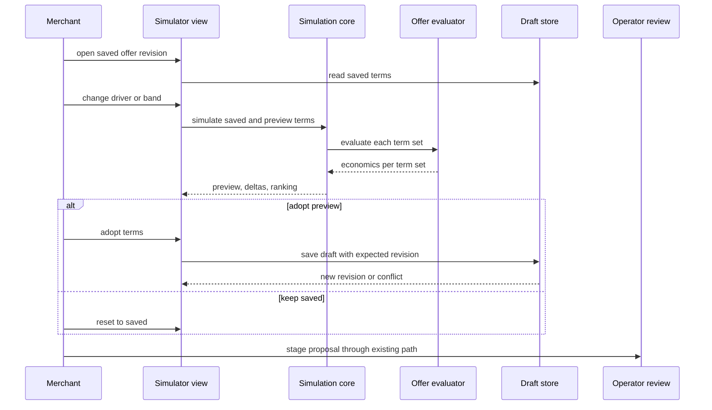
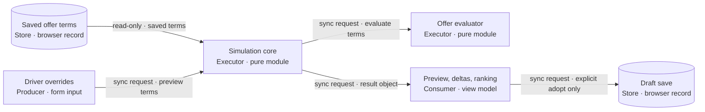
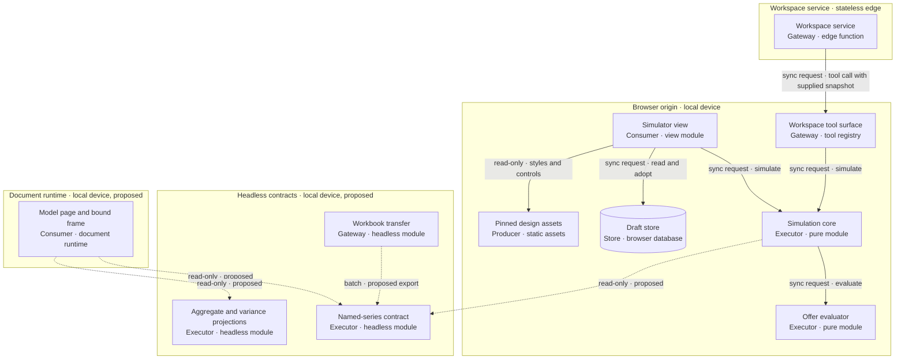

# Driver Planning Model

**Join:** `PRD-TAD-ADR-DRIVER-PLANNING-MODEL-001@0.1.0` · one combined artifact, five section roles.

**Reference implementation scope.** Every repository, path, symbol and check named in this document belongs to this stack's reference implementation. The requirements themselves are stated by function.

**Reference-use restriction.** No external product, asset, prose, formula, sample data or dependency is named, copied or required by this plan. No non-native input is adopted, so every capability claim below rests on the native grounding record only. Conceptual input proves no native capability.

## Opening Directive and Next Outcome

**DIR-DPM-01** — Context: the commerce workspace already estimates one offer's economics from saved terms (`launch.js` at the grounded revision), and the workbook, record, transfer, document and design owners each hold a partial planning capability with no shared model. Intent: a merchant sees how each price or cost driver changes the result before staging an offer, and later phases grow that into a shared driver model. Directive: specify one MVP slice on existing owners, then sequence the remaining owners by reuse. Role: Product Manager function. Action: author one joined plan. Outcome: this artifact at `@0.1.0` with VCCs, owners and bounds; check: independent conformance review (not yet run).

| As of · stage | Customer / payer · offer / channel | Last outcome · evidence | Delivery owner · next business outcome | Riskiest H-id · threshold / window | Cash / time bound · source | Next decision · trigger |
|---|---|---|---|---|---|---|
| 2026-11-25 · discover | Solo merchant preparing an offer · existing local-first vendor workspace | Plan authored · no user evidence | Commerce workspace owner · merchant adopts simulated terms and stages a proposal | H-DPM-01 · at least 3 of 5 observed merchants change terms after simulating and stage a proposal in the same session / 14 days | $0 spend, about 6 active hours (author estimate, unmeasured) · this record | Continue to Phase R2 or stop · E-DPM-01 result |

**Ranked next outcome.** Uncertainty resolved: whether merchants act on driver feedback (H-DPM-01, `unvalidated`). Cheapest sufficient method: ship the MVP simulator on the existing offline route and observe five merchant sessions. Threshold and window: as in the snapshot. Stop condition: fewer than 2 of 5 change terms, in which case later phases are not started. Bounds: $0 spend, zero runtime tokens, no new dependency, at most 3 new source modules, under 600 lines per file, lazy-loaded.

## Codebase Grounding Record

Observed 2026-11-25 with `agentic-os context map/search/read` (lexical, working tree) and `shasum -a 256`. Digests are 16-hex prefixes of current bytes; recompute before relying on a row. A confirmed gap is planned work, never existing capability.

| ID | Source owner @ revision | Path · digest prefix | Inspected symbol / current capability | Confirmed gap |
|---|---|---|---|---|
| G-01 | `agentic-commerce-os@faf8e12f0eba` | `public/local-first/launch.js` · `1cecd5da81c5e6d8` | `evaluateOfferSetup`, `evaluateLaunch` return frozen economics: `contributionMinor`, `firstSaleNetMinor`, `tenSalesNetMinor`, `breakEvenSales`, `constraints`, `estimate: true`, `demandStatus: 'unvalidated'` | One term set at a time; no comparison, no driver ranking |
| G-02 | `agentic-commerce-os@faf8e12f0eba` | `public/local-first/drafts.js` · `dfaddf0b861b53d7` | `LAUNCH_MONEY_FIELDS` (price, four variable costs, fixed cost), `MAXIMUM_AMOUNT_MINOR`, `validLaunchTerms`; `saveDraft(input, expectedRevision)` rejects a stale revision with `draft_revision_conflict` | No preview state; a save is the only way to try terms |
| G-03 | `agentic-commerce-os@faf8e12f0eba` | `public/local-first/workspace-capabilities.js` · `0f3b3b2065885359`; `src/local-first/workspace-service.ts` · `33f2eafae9139383` | `WORKSPACE_TOOLS` (four read-only tools, including `commerce.workspace.offer.review`); the service serves that list over REST, an invocation route, MCP and a descriptor that declares `persistence: 'none'` and `registryAdmission: 'not-claimed'` | No simulate tool |
| G-12 | `agentic-commerce-os@faf8e12f0eba` | `public/local-first/app.js` · `e7b7fa0053e0e35c` (410 lines) | `setupState()` calls `evaluateOfferSetup` on the editor's current input | No simulator mount; the file has room for an import only |
| G-13 | `agentic-commerce-os@faf8e12f0eba` | `test/local-first/workspace-invocation.test.mjs` · `1b7b7b8e81ea46b5`; `test/local-first/offer-setup.test.mjs` · `198d035b0a1079c7` | Asserts the descriptor and MCP tool lists equal `WORKSPACE_TOOLS` and binds the four tools by position; both run under `npm run check:local-first`, which also runs the browser release check | No simulation fixture; a new tool must be appended after the existing four |
| G-04 | `agentic-commerce-os@faf8e12f0eba` | `public/local-first/sme-decision-contract.js` · `18cec36aaf885e90` | `baselineProposal`, `confirmBaseline`, `projectDeltas` compare slots against a confirmed baseline for the business pack | Bound to pack rows; not reusable for offers without change |
| G-05 | `agentic-commerce-os@faf8e12f0eba` | `src/core/revenue-ledger.ts` · `3783e1201ca9fab8` | `RevenueLedger` stores settled `revenue_line` rows; `MAXIMUM_REVENUE_PERIOD_LINES = 500` | No plan-versus-actual projection; no buyer identity |
| G-06 | `agentic-sheets@87a0f0f95f1f` | `sheets/formula.mjs` · `726b053ecfbd24b3`; `sheets/schema.mjs` · `8e2605a7e175480f` | `listFunctions` returns one function (`math.sum`); cell-address formulas; `LIMITS` 512 populated cells, 64 formulas | No named series, period offset, rule scope or scenario |
| G-07 | `agentic-base@0157d4c1f34b` | `src/projectors.mjs` · `f406668c2b3499f7` | `projectMatrix` counts records per row/column key | No measure aggregation, time buckets or variance |
| G-08 | `agentic-base@0157d4c1f34b` | `packages/views-react/src/dashboard/DashboardCharts.tsx` · `7e6f252084cfb288` | `DashboardLineAreaChart`, `DashboardBarChart` | No diverging bar or delta indicator |
| G-09 | `agentic-design-system@9f2b1ca2b724` | `site/key-type-value.js` · `bad726f895362084`; `site/dashboard.mjs` · `51540004790d7c6c`; `site/dashboard-range.mjs` · `6b82a24c165c2286` | Key/type/value rows, dashboard primitives, `createDashboardRange`, grid-cell and three reference-label slots | No input/computed cell role, saved-value tick, diverging bar |
| G-10 | `agentic-gateway@995041137eff` | `transfer/record-export.mjs` · `79e108308b536935` | `recordFormats`: CSV, JSON, Markdown for one record view | No multi-sheet workbook transfer |
| G-11 | `agentic-graph@51a9e2086bde` | `canvas/src/features/rich-media/financialModelWorkbook.ts` · `d6d03be980c70fe4`; `canvas/src/components/EmbeddedCanvasPreviewFrame.tsx` · `9f6e2c34b1d1b8e9` | `buildFinancialModelWorkbookFromMarkdown` (one table to a spreadsheet companion); script-only sandboxed preview frame | No model-page document type or data-bound frame contract |

**Grounding gaps.** GAP-1: whether the browser release check exercises an offline reload of the offer editor (the script was located, not read). GAP-2: the delivered state of every owner (no deployed surface was observed). GAP-3: none of the named checks was run for this record. Each is resolved at START by an exact-hash read or a run; none is assumed.

## PRD

### Feature: Offer Driver Simulator (F-01)

**Problem statement.** A merchant who has saved offer terms sees one estimate. To learn what a lower price or a higher delivery cost would do, the merchant must overwrite the saved terms, read the new estimate, and remember the old one. Impact: terms are staged without knowing which driver matters most. Opportunity: compare a preview against the saved terms and rank the drivers, without changing anything until the merchant chooses to.

**Personas.**

| Persona | Job to be done | Current workaround |
|---|---|---|
| P-1 Solo merchant | Decide price and cost terms before staging an offer | Edit saved terms repeatedly and compare from memory |
| P-2 Merchant's agent | Prepare a reviewed offer through the read-only workspace tools | Call the review tool once per hand-edited snapshot |
| P-3 Operator | Approve a staged proposal | Reads the single estimate; unaffected by this slice |

### Journey: Solo merchant — choose offer terms with confidence

| Stage | Action | Touchpoint | Pain point | Opportunity |
|---|---|---|---|---|
| Trigger | Doubts a price or cost after saving terms | Vendor offer editor | No way to test a doubt safely | Offer a preview that changes nothing |
| Discover | Opens the simulator for the saved offer revision | Simulator view | Estimate shown without context | Show saved result beside preview |
| Engage | Changes drivers; reads deltas and the driver ranking | Simulator view | Cannot tell which driver matters | Rank drivers by effect |
| Complete | Adopts the preview or keeps saved terms | Existing draft save | Fear of losing the saved terms | Adoption is explicit and revisioned |
| Return | Re-runs after a cost or price changes | Simulator view | Repeats manual comparison | Saved terms reload as the baseline |

**Diagram D-01** · Class: Journey stage map · Notation: `flowchart LR` · Version: 1 — 2026-11-25
**Caption**: User Journey Flow: the merchant moves from doubt to an explicit adopt-or-keep decision, and re-enters at Engage.

The journey table above is the inventory for D-01: one row per node, in order.

### Pain-Point-to-Feature Mapping

| Pain point | Evidence status | Hook | Break | Fix | Close | Min-time-resource-max-value note |
|---|---|---|---|---|---|---|
| PP-01: cannot see how a driver changes the offer result without overwriting saved terms | `unvalidated` (bounded learning hypothesis H-DPM-01) | "What if delivery costs 10% more?" | The only way to check is to overwrite the saved terms | Preview versus saved, with deltas and a driver ranking, from the existing estimate | Adopt the preview as a new draft revision, or keep the saved terms | Reuse the evaluator, money fields, draft store, read-only tool pattern and pinned design assets; build one pure module, one view, one tool entry |

The hook and close claim no forecast, demand or payment capability: outputs stay labelled as estimates with demand unvalidated.

### User Stories and Acceptance Criteria

- **US-01** (Engage): As a solo merchant I want to change price and cost drivers in a preview so that I see the effect before I change my offer.
- **US-02** (Engage): As a solo merchant I want the drivers ranked by effect so that I know which term to negotiate first.
- **US-03** (Complete): As a solo merchant I want adoption to be an explicit, revisioned save so that I never lose my saved terms by exploring.
- **US-04** (Discover): As a merchant's agent I want a read-only simulate tool so that I can prepare terms without mutation authority.

| ID | Given / When / Then | VCC: verify … by … with … |
|---|---|---|
| VCC-DPM-01 | Given a saved offer revision with valid terms, when preview driver values are supplied, then every preview output equals the existing estimate for those terms | Verify preview outputs equal `evaluateLaunch` outputs for a fixture set by `npm run check:local-first`, with no existing fixture expectation changed |
| VCC-DPM-02 | Given saved and preview terms, when the comparison is produced, then each numeric delta is preview minus saved in integer minor units and an unreachable break-even is reported as not reachable, never as zero | Verify delta fixtures by `npm run check:local-first`, with no floating-point money value in the result |
| VCC-DPM-03 | Given valid terms and a band from 1 to 50 percent, when drivers are ranked, then the order and swings match the fixture and ties follow the declared field order; a band outside the range is rejected | Verify ranking and rejection fixtures by `npm run check:local-first`, stop after 10 iterations |
| VCC-DPM-04 | Given any simulation, when it completes, then the stored offer snapshot bytes and offer revision are unchanged, and adoption changes them only through the existing draft save | Verify snapshot digest equality before and after simulation by `npm run check:local-first`, with no approval, export or publication call |
| VCC-DPM-05 | Given the workspace tool list, when it is inspected, then the simulate tool is declared read-only and idempotent, appears once after the existing four, and the descriptor and MCP lists still equal the list | Verify by the workspace invocation test under `npm run check:local-first`, with no existing tool definition or position changed |
| VCC-DPM-06 | Given the simulator view after an offline reload, when it renders, then it works without network and uses only pinned shared design assets | Verify by a browser case added to the release check under `npm run check:local-first`, with no new style rule for a shared role in the consumer |
| VCC-DPM-07 | Given any result, when it is shown or returned, then it carries the estimate flag and unvalidated demand status from the existing estimate | Verify result fixtures by `npm run check:local-first`, with no copy implying forecast or collected revenue |

### Success Metrics

| Metric | Baseline | Target | Timeline |
|---|---|---|---|
| Observed merchants who change terms after simulating and stage a proposal in the session | none observed | at least 3 of 5 | 14 days after local proof |
| Readiness rung (local / delivered) | `spec-complete` / `undocumented` | `runtime-ready` / `undocumented` | Phase R1 exit |
| Time-to-value (TTV steps) | 3 (estimate, not walked through) | at most 3 | before Phase 3 sign-off |
| Time-to-value (TTV elapsed) | 2 min (estimate, not walked through) | at most 2 min | before Phase 3 sign-off |
| Token cost / month | 0 | 0 | always |
| Monthly TCO | $0 | $0 | always |
| ROI score | unscored: reach unmeasured | owner sets threshold after E-DPM-01 | Phase R1 exit |

**Time-to-value.** Persona P-1; zero state is a saved offer with valid terms on the offline route. First-value action: change one driver and read its delta. Validation: timed walk-through on a clean profile, not yet done.

**Agent experience assessment.** Rubric revision: maturity module under guideline 3.5.1. All four criteria are `unassessed` at `@0.1.0`: no observation exists. Gap owner: Commerce workspace owner; next check: E-DPM-01 sessions.

### MoSCoW, Scope and Dependencies

- **Must** (F-01): M1 preview versus saved (VCC-01, 02); M2 driver ranking (VCC-03); M3 no mutation without explicit adoption (VCC-04); M4 read-only tool (VCC-05); M5 offline with pinned design assets (VCC-06); M6 estimate labelling (VCC-07).
- **Should**: S1 named-series model contract with period offset, error fallback and rule scopes (F-02); S2 shared visual primitives for driver models (F-03).
- **Could**: C1 measure aggregation and variance projections (F-04); C2 plan versus settled actuals (F-05); C3 model pages with data-bound frames and lineage (F-06); C4 multi-sheet workbook transfer and an actuals-source capability class (F-07).
- **Won't (this increment)**: buyer cohort analysis (no buyer identity in the ledger, G-05); slide or document export; chat channels; any hosted or paid service.

**Min-viable scope.** F-01 only, on the existing local-first route, for one saved offer revision. **Out of scope.** Every Should, Could and Won't item; live quotes; payment; publication authority. **Dependencies.** G-01 to G-03, G-12, G-13, the pinned design assets already shipped with the route, and resolution of GAP-1.

**Ecosystem outcome and evidence.** Merchant receives a clearer pre-publication decision; the operator receives better-reasoned proposals; no payer is added by this slice. Pain evidence: hypothesis only. Outcome and window: the first success metric. Join: TAD Ecosystem Contract at `@0.1.0`.

**Reuse outcome.** Consumers: the vendor editor and the workspace tool surface, both calling one simulation core. Duplicate behavior observed: delta projection exists separately for the business pack (G-04); integration time, repeated actions and support cost are unmeasured. Join: TAD reuse record.

**Open questions.** OQ-1: is ten-sales net the right ranked output for merchants, or should the merchant choose. OQ-2: default band (10 percent proposed). OQ-3: whether adoption should pre-fill the editor or save directly.

## TAD

### Architecture: Offer Driver Simulator

**From saved terms and preview values to a comparison**: view → simulation core → existing evaluator → preview, deltas and ranking → optional explicit adoption through the existing draft save.

### Journey → System Mapping

| Journey stage | Workflow | Data flow | Orchestration/harness flow | Topology node(s) | Component |
|---|---|---|---|---|---|
| Discover | WF-01 steps 1–2 | DF-01 `d_saved` | N/A: deterministic arithmetic, no model call | `t_view`, `t_store` | CMP-VIEW |
| Engage | WF-01 steps 3–7 | DF-01 `d_levers` to `d_result` | N/A: same reason | `t_view`, `t_core`, `t_eval`, `t_tool` | CMP-CORE, CMP-TOOL |
| Complete | WF-01 adopt or keep | DF-01 `d_adopt` | N/A: same reason | `t_view`, `t_store` | CMP-VIEW |
| Trigger, Return | N/A: no system step before opening | N/A: no data moves | N/A: same reason | N/A: outside the system | — |

All five flow types are classified: journey (D-01), workflow (D-02), data flow (D-03) and topology (D-04) apply; orchestration/harness is not applicable because no AI pipeline exists in any phase specified here. Lane movement is covered by the Deploy Boundary Register; its diagram is drawn before the first promotion, and none is in scope.

### Workflow: WF-01 Simulate and Adopt

**Trigger**: merchant opens the simulator on a saved offer revision. **Actors**: merchant, simulator view, simulation core, offer evaluator, draft store, operator review.

**Diagram D-02** · Class: User workflow · Notation: `sequenceDiagram` · Version: 1 — 2026-11-25
**Caption**: Workflow Flow: simulation only reads; the single write is an explicit adoption through the existing draft save.

Inventory for D-02: Merchant (Actor), Simulator view (CMP-VIEW), Simulation core (CMP-CORE), Offer evaluator (CMP-EVAL), Draft store (CMP-DRAFTS), Operator review (existing, unchanged).

- **Happy path**: 1 open; 2 read saved terms; 3 change a driver; 4 simulate; 5 evaluate both term sets; 6 return result; 7 render; then adopt (new draft revision) or keep.
- **Alternate paths**: preview makes contribution non-positive → the evaluator's existing constraint is shown and adoption stays available only through the existing validation; saved terms incomplete → the simulator is unavailable and names the missing fields.
- **Error paths**: preview value out of range or non-integer → typed rejection naming the field, no result; draft save conflict → saved terms reload and the preview is kept for a retry.
- **Postconditions**: without adoption, stored bytes and revision are identical; with adoption, exactly one new draft revision exists and nothing is approved, exported or published.

### Data Flow: DF-01 Terms to Comparison

**Diagram D-03** · Class: Data flow · Notation: `flowchart LR` · Version: 1 — 2026-11-25
**Caption**: Data Flow: saved terms and preview values pass through one pure core and reach storage only on explicit adoption.

| Node | Stage | Component | Input format | Output format | Persistence | Error handling |
|---|---|---|---|---|---|---|
| `d_saved` | Ingest | CMP-DRAFTS | offer ID and revision | launch terms, integer minor units | browser database, existing retention | unavailable when terms are invalid |
| `d_levers` | Ingest | CMP-VIEW | form values | partial terms override | none | field-level rejection |
| `d_core` | Transform | CMP-CORE | saved terms, preview terms, band percent | result object: preview, deltas, ranking, flags | none | fail fast with typed error |
| `d_eval` | Transform | CMP-EVAL | launch terms | frozen economics | none | existing validation error |
| `d_result` | Serve | CMP-VIEW, CMP-TOOL | result object | rendered rows or tool response | none | shows the typed error |
| `d_adopt` | Store | CMP-DRAFTS | full terms and expected revision | new offer revision | browser database | conflict leaves stored bytes unchanged |

### Topology

**Version**: 1 — 2026-11-25. **Boundaries**: workspace service; browser origin; headless contracts; document runtime. Solid edges are runtime calls in the MVP; dotted edges are proposed dependencies of later phases.

**Diagram D-04** · Class: Runtime topology · Notation: `flowchart TB` with one subgraph per boundary · Version: 1 — 2026-11-25
**Caption**: Topology: the merchant path stays in one browser origin; the existing stateless service serves the same tool list; later owners attach through read-only contracts.

| Node | Role | Type | Lane | Connects to | Connection type | Data residency |
|---|---|---|---|---|---|---|
| `t_service` (CMP-SVC) | Gateway | edge function | Authoring | `t_tool` | sync request | request-scoped; descriptor declares no persistence |
| `t_view` (CMP-VIEW) | Consumer | view module | Authoring | `t_core`, `t_store`, `t_ds` | sync request; read-only | local device |
| `t_tool` (CMP-TOOL) | Gateway | tool registry | Authoring | `t_core` | sync request | local device, or the caller's supplied snapshot |
| `t_core` (CMP-CORE) | Executor | pure module | Authoring | `t_eval`; `t_sheets` proposed | sync request; read-only | local device |
| `t_eval` (CMP-EVAL) | Executor | pure module | Authoring | — | — | local device |
| `t_store` (CMP-DRAFTS) | Store | browser database | Authoring | — | — | local device |
| `t_ds` (CMP-DS) | Producer | static assets | Authoring | — | — | local device |
| `t_sheets` (CMP-SERIES) | Executor | headless module | Authoring | — | — | local device |
| `t_base` (CMP-AGG) | Executor | headless module | Authoring | — | — | local device |
| `t_gateway` (CMP-XFER) | Gateway | headless module | Authoring | `t_sheets` proposed | batch | local device |
| `t_graph` (CMP-PAGE) | Consumer | document runtime | Authoring | `t_sheets`, `t_base` proposed | read-only | local device |

### Component Specifications

**CMP-CORE — Simulation core** (new). Responsibility: the core compares two term sets and ranks drivers. Interfaces: `simulateOffer({ saved, preview })` → `{ saved, preview, deltas, flags }`; `rankSensitivity({ terms, bandPercent })` → ordered `{ field, lowTerms, highTerms, low, high, swing }`. Rules: a flexed value is the driver times (100 ± band) / 100 in integer minor units, rounded half up, clamped to 0 and `MAXIMUM_AMOUNT_MINOR`; swing is the absolute difference in ten-sales net; ties follow `LAUNCH_MONEY_FIELDS` order; a break-even that is unreachable on either side yields a null delta with reason `not_reachable`. Dependencies: CMP-EVAL, `drafts.js` constants. Configuration: band default 10, range 1–50. FOSS / vendor: FOSS, native, zero dependencies. Harness contract, token budget, orchestration topology: not applicable, no AI component. VCCs: 01, 02, 03, 04, 07. Evidence References: none recorded. Readiness: local `spec-complete` / delivered `undocumented`.

**CMP-VIEW — Simulator view** (new). Responsibility: the view renders drivers, comparison and ranking and requests adoption. Interfaces: lazy-loaded from the offer editor beside `setupState()` (G-12); calls CMP-CORE; adopts through `saveDraft` with the expected revision (G-02). Dependencies: CMP-DS. VCCs: 04, 06. Evidence References: none. Readiness: `spec-complete` / `undocumented`.

**CMP-TOOL — Simulate tool** (extension of the existing registry). Responsibility: the registry exposes one read-only simulate tool. Interface: `commerce.workspace.offer.simulate` with offer ID, optional preview terms, optional band, and the existing snapshot argument; appended after the existing four tools (G-13). The existing service serves it without a service change, because it serves the list as a whole (G-03). VCCs: 05, 07. Evidence References: none. Readiness: `spec-complete` / `undocumented`.

**Existing, unchanged**: CMP-EVAL (`launch.js`), CMP-DRAFTS (`drafts.js`), CMP-SVC (`workspace-service.ts`), CMP-DS (pinned shared design assets). **Proposed, later phases, no VCC yet**: CMP-SERIES, CMP-AGG, CMP-XFER, CMP-PAGE.

**Integration contracts.** Interface: simulation result · Protocol: in-process module call and the existing browser tool registration · Format: JSON-serializable object, integers for money · Errors: typed code plus field name; no partial result.

### Ecosystem Contract

**Owns**: the Ecosystem record at `PRD-TAD-ADR-DRIVER-PLANNING-MODEL-001@0.1.0`; the PRD owns the customer outcome.

| Participant / job | Value exchange / payer | Native owner / exact revision | Interface / authority | Current evidence / gap | Cost, privacy and exit |
|---|---|---|---|---|---|
| Merchant / choose terms | Clearer decision; no payment in this slice | CMP-CORE, CMP-VIEW on `agentic-commerce-os@faf8e12f0eba` (smallest delta: 2 modules) | View; may save own draft only | None / E-DPM-01 | $0; terms stay in the browser origin; remove the view to exit |
| Merchant's agent / prepare terms | Faster preparation; none | CMP-TOOL extends `WORKSPACE_TOOLS` | Read-only tool; no mutation authority | None / VCC-05 | Zero tokens for discovery and read |
| Operator / approve proposal | Better-reasoned proposals; none | Existing review path, unchanged | Existing approval authority | Unchanged | Unchanged |
| Design owner / shared roles | Consistent controls; none | `agentic-design-system@9f2b1ca2b724`, consumed by pin | Immutable projection; no consumer override | None / VCC-06 | Repin to exit |

**Developer path**: discover the tool in the existing service descriptor → rehearse offline with a supplied snapshot → invoke read-only → no events → no reconciliation (no value moves) → support through the owning repository → retire by removing the tool entry and its check together. **Invocation join**: see the register below; no new route token is added. **Dependency order** (build and release, acyclic): design owner → record owner → workbook owner → transfer owner → commerce owner → document owner. **External seams**: none; zero-spend holds without a fallback.

### Shared Utility and Invocation Reuse

**Owns**: the reuse record at `@0.1.0`. **Inventory join**: component IDs above; no parallel register.

| Capability / pain-VCC | Source export / revision / consumers | Decision / smallest delta | Runtime boundary / deliberate differences | Acceptance check / removal or retention |
|---|---|---|---|---|
| Offer estimate / VCC-01 | `evaluateLaunch`, G-01; consumers: launch review, review tool | `reuse` / none | pure, browser-safe | VCC-01 / retained |
| Money fields and bounds / VCC-03 | `LAUNCH_MONEY_FIELDS`, `MAXIMUM_AMOUNT_MINOR`, G-02 | `reuse` / none | pure | VCC-03 / retained |
| Read-only tool definition / VCC-05 | `WORKSPACE_TOOLS` definition helper, G-03 | `extend-owner` / one entry | browser tool surface | VCC-05 / retained |
| Baseline deltas / VCC-02 | `projectDeltas`, G-04; consumer: business pack | `retain-local` / none now | domain rule bound to pack rows; offers use integer money deltas | VCC-02 / revisit under ADR-2 |
| Named-series evaluation | none exists (G-06) | `defer` / ADR-2 | pure contract, proposed | two concrete consumers required first |
| Shared visual roles / VCC-06 | pinned key/type/value rows, dashboard primitives, table frame, G-09 | `reuse` / none in MVP | view | VCC-06 / new roles land at the owner first (ADR-3) |

**Invocation Register: Driver Planning Model**

| Route | Kind | Owner | Typed arguments | Trust boundary | Token cost |
|---|---|---|---|---|---|
| `commerce.workspace.offer.simulate` | Tool identity (proposed) | Commerce workspace owner | offer ID, optional preview terms, optional band 1–50, snapshot | read | 0 |

Federation: the tool is served through the owner's existing MCP endpoint and descriptor once it is in the tool list; registry admission stays not claimed. The owner's own Invocation Register and capability catalog gain the entry in the same change. Modes: browser view, REST, the existing invocation grammar and MCP all resolve the tool by name from the one list; no mode gains write authority.

**Compatibility cases**: valid and invalid integers, missing fields, band limits, zero and maximum amounts, non-positive contribution, unreachable break-even, stale revision on adoption. **Migration and recovery**: additive; rollback removes the three additions and leaves stored drafts untouched. **Budgets**: always-load delta 0 bytes; lazy modules at most 3, each under 600 lines; $0.

**Value-moving flow and policy evidence.** Not applicable: the slice estimates and saves drafts; it authorizes, submits and settles nothing. Reviewer: Commerce workspace owner. Coverage row C06.

### Native Design Adoption Record

| Concern | Native owner at exact revision | Reused surface or utility | Acceptance check and result | Gap / next check |
|---|---|---|---|---|
| Identity and illustration | not applicable: no identity change | — | — | — |
| Settings and preferences | `agentic-design-system@9f2b1ca2b724` | Existing appearance settings, unchanged | none recorded | confirm no new preference at START |
| Tokens and render adapters | same; `site/tokens/shared-ui-profile.json` · `bab5811bcd4aa820` | Pinned shared profile already shipped with the route | VCC-06, none recorded | new roles (ADR-3) are owner work, not consumer styles |
| Typography and ideograms | same | Tabular numerals and detail typography for money; shared icon registry | VCC-06, none recorded | forced-colors pass |
| Editor surface | same; `site/key-type-value.js` | One key/type/value row per driver; a slider and its number field edit one value | VCC-06, none recorded | confirm the row supports a range control at START |
| Status and evidence | same; `site/dashboard.mjs` | Dashboard primitives for comparison cards; table frame for ranking | VCC-06, none recorded | diverging bars deferred to Phase R2 |

### Quality Attributes

| Attribute | Scenario | Pattern | Validation |
|---|---|---|---|
| Performance | One simulation performs 2 evaluations; one ranking performs 12 | Pure synchronous functions | Fixture timing in the local check; no target claimed yet |
| Scalability | One offer revision per simulation | No shared state | Not applicable beyond one offer |
| Security | Untrusted snapshot supplied to the tool | Existing schema validation; read-only tool; no mutation path | VCC-04, VCC-05 |
| Observability | Rejections must be diagnosable | Typed error code and field | Fixture assertions |
| Token cost | Zero tokens per request | No model call | Not applicable: no cost log needed |
| Offline behaviour | Connectivity lost after first load | All modules in the offline shell | VCC-06 |
| TCO | $0 per month; one deployment model (static assets) | No service, no dependency | Monthly review unnecessary while unchanged |
| Device reach | Coarse pointer and narrow viewport | Shared control geometry from the design owner | VCC-06 on a touch context |

**Deployment strategy.** Static assets with a versioned offline cache; rollback is the predecessor asset revision. **Human gates.** Protected pull-request integration with required checks; operator approval for publication (existing, unchanged); an explicit operator instruction at each Deploy Boundary. **Ceilings.** No agentic loop exists; the build task is capped at 3 alignment cycles and 10 check iterations per VCC.

### Diagram Register

| Diagram | Class | Notation | Surface | Projects | Nodes | Edges | Clusters | Version |
|---|---|---|---|---|---|---|---|---|
| D-01 | Journey stage map | `flowchart LR` | authoring | yes | 5 | 5 | 0 | 1 |
| D-02 | User workflow | `sequenceDiagram` | authoring | no | 0 | 0 | 0 | 1 |
| D-03 | Data flow | `flowchart LR` | authoring | yes | 6 | 5 | 0 | 1 |
| D-04 | Runtime topology | `flowchart TB` | authoring | yes | 11 | 10 | 4 | 1 |

The Evidence Reference for these counts is at the end of this document.

### Component Inventory

| Layer | Component | File / module | Local rung | Delivered rung |
|---|---|---|---|---|
| Domain | CMP-CORE | `public/local-first/offer-simulator.js` (new) | `spec-complete` | `undocumented` |
| View | CMP-VIEW | `public/local-first/offer-simulator-view.js` (new) | `spec-complete` | `undocumented` |
| Adapter | CMP-TOOL | `public/local-first/workspace-capabilities.js` (extend) | `spec-complete` | `undocumented` |
| Domain | CMP-EVAL, CMP-DRAFTS | `launch.js`, `drafts.js` (existing) | not derived here | not derived here |
| Adapter | CMP-SVC | `src/local-first/workspace-service.ts` (existing, unchanged) | not derived here | not derived here |
| View | CMP-DS | pinned shared design assets (existing) | not derived here | not derived here |
| Proposed | CMP-SERIES, CMP-AGG, CMP-XFER, CMP-PAGE | owners in the roadmap | `undocumented` | `undocumented` |

Existing components carry no rung here because this record holds none of their Evidence References.

### Deploy Boundary Register

| Boundary | From lane | To lane | Evidence Reference | Operator instruction | Rollback statement | State |
|---|---|---|---|---|---|---|
| `boundary-authoring-to-mirror` | Authoring | Mirror | none recorded | none | predecessor asset revision; owner's release check | `closed` |
| `boundary-mirror-to-delivery` | Mirror | Delivery | none recorded | none | predecessor delivered revision; owner's release check | `closed` |

## ADR

### ADR-1: Calculate the MVP on the existing offer evaluator

**Status**: Proposed · **Date**: 2026-11-25

**Context.** The simulator needs a calculation owner. **Decision.** Reuse `evaluateLaunch` unchanged and add one pure core beside it.

**Constraints (Stage 1).** K1 $0 spend; K2 no new runtime dependency; K3 works offline in the browser; K4 one owner per capability.

| Candidate | K1 | K2 | K3 | K4 | Disposition |
|---|---|---|---|---|---|
| A: existing evaluator plus pure core | pass | pass | pass | pass | `pass` |
| B: build the named-series contract first, then simulate on it | pass | pass | pass | pass | `pass` |
| C: adopt a third-party FOSS formula library | pass | fail | pass | fail | `fail-K2` |

**Outranking (Stage 2).** Criteria from the governing requirements: proximity to built capability, distance to a first observed merchant outcome, size of new delta. A is no worse than B on all three and strictly better on each (B needs a new contract and a second consumer before it can ship). A outranks B. **Argumentation (Stage 3).** Not applicable: one candidate dominates and no assumption is contested.

**Reuse compatibility decision.** Direct owner reuse; no adapter, no extraction. Input, error and digest contracts are those of the existing evaluator. Nothing is removed. Rollback deletes the new core.

| Dimension | A: static assets | Best FOSS alternative (C): static assets | Delta / 12 months |
|---|---|---|---|
| Infra, egress, token cost | $0 / $0 / $0 | $0 / $0 / $0 | $0 |
| Ops burden | Low | Medium (pin, license notice, audit) | — |
| Vendor risk | Low | Low | — |

**Consequences.** Positive: smallest delta; existing validation applies. Negative: the core knows offer fields, so it is not general. Neutral: ADR-2 may later host the same rules. **Revisit trigger**: a second concrete consumer of driver simulation exists.

### ADR-2: Add named series as a sibling contract in the workbook owner

**Status**: Proposed, gated · **Date**: 2026-11-25

**Context.** Later phases need named metrics over periods, a previous-period reference, error fallback, rules scoped by time grain and by actual or forecast, and scenario overrides. The workbook owner has cell-address formulas only (G-06). **Decision.** Extend the workbook owner with a sibling, versioned contract that compiles to its existing evaluator, and register new functions through its existing function registry. **Alternatives.** 1 Extend the cell contract in place: reuses one schema, but changes saved-workbook semantics and limits. 2 Place it in the record owner: closer to dimensions, but creates a second formula owner. 3 FOSS spreadsheet engine: broad coverage, fails K2. **Rationale.** One formula owner; saved workbooks stay valid. **Reuse compatibility.** Generic extraction is admitted only with two concrete consumers (the simulator core and a model page); until then `defer`. **TCO.** $0 for every option in the single static deployment model. **Consequences.** Positive: one engine for commerce and documents. Negative: workbook limits need a reviewed revision. **Recovery**: the sibling contract is additive and removable.

### ADR-3: Shared visual roles land at the design owner before any consumer

**Status**: Proposed · **Date**: 2026-11-25

**Context.** Driver models need an input-versus-computed cell role, formula chips, a range control with a saved-value tick, a diverging bar and a delta indicator; none exists (G-08, G-09). **Decision.** The MVP uses existing roles only. New roles are added at the design owner, with a non-color distinction and a forced-colors pass, and consumers adopt them by exact pin. **Alternatives.** 1 Style them in each consumer: fastest, but creates duplicate owners and overrides. 2 FOSS chart library: more chart types, fails K2 and adds a second visual owner. **TCO.** $0 either way. **Consequences.** Positive: one owner, consistent across products. Negative: Phase R2 visuals wait for the design owner. **Recovery**: repin to the predecessor.

## MVP

### MVP: Offer Driver Simulator

**Projects**: PRD Must M1–M6 · TAD CMP-CORE, CMP-VIEW, CMP-TOOL · ADR-1, ADR-3 at `PRD-TAD-ADR-DRIVER-PLANNING-MODEL-001@0.1.0`.

| Feature | VCC | Evidence Reference | Local rung | Delivered rung |
|---|---|---|---|---|
| M1 | VCC-DPM-01, 02 | none recorded | `spec-complete` | `undocumented` |
| M2 | VCC-DPM-03 | none recorded | `spec-complete` | `undocumented` |
| M3 | VCC-DPM-04 | none recorded | `spec-complete` | `undocumented` |
| M4 | VCC-DPM-05 | none recorded | `spec-complete` | `undocumented` |
| M5 | VCC-DPM-06 | none recorded | `spec-complete` | `undocumented` |
| M6 | VCC-DPM-07 | none recorded | `spec-complete` | `undocumented` |

**Demo Skeleton** (budget 120 s): Hook 15 s — "what if delivery costs 10 percent more?" · Probe 20 s — show that saved terms give one estimate · Reveal 40 s — VCC-DPM-01 to 03 holding: preview, deltas and ranking appear while the saved revision is unchanged · simulate-and-adopt 30 s — adopt the preview and see one new draft revision · Close 15 s — stage the proposal through the existing path. Total 120 s.

**Domain-object rubric.** Domain object: one saved offer revision. Current contiguous level: unassessed. Blocker for any rating: CMP-CORE does not exist. **Won't (this increment)**: as listed in the PRD.

### Roadmap

**Owner and join**: one product-owned roadmap at `@0.1.0`. Every pain below is a hypothesis; order follows proximity to built capability, then distance to a first collected dollar.

| Phase / outcome | Pain evidence / rank | Reuse / new delta / owner | Prerequisite / exit VCC | Bounds / wait condition | Stop, recovery / next check |
|---|---|---|---|---|---|
| R1 Merchant simulates and adopts terms (F-01) | PP-01 hypothesis / 1: nearest to built and to the offer path | G-01 to G-03, G-09, G-12, G-13 / 2 modules, 1 tool entry / commerce owner | GAP-1 resolved / VCC-01 to 07 | about 6 active hours (estimate); 3 modules; $0; 0 tokens | E-DPM-01 below threshold stops R2 onward / remove additions |
| R2 Shared visual roles for driver models (F-03) | hypothesis / 2: unblocks every later view | G-09 / new roles / design owner | R1 exit and ADR-3 accepted / owner release check | not estimated; $0 | no consumer adopts within one increment / repin |
| R3 Named-series contract (F-02) | hypothesis / 3 | G-06 / sibling contract, functions / workbook owner | ADR-2 accepted with two consumers / new VCCs at successor revision | not estimated; $0 | second consumer absent / additive removal |
| R4 Aggregates and variance (F-04) | hypothesis / 4 | G-07, G-08 / projection options / record owner | R2 / new VCCs | not estimated; $0 | no consumer / remove options |
| R5 Plan versus settled actuals (F-05) | hypothesis / 5: first use of real sales | G-05 / read-only projection / commerce owner | R4 and settled lines exist / new VCCs | waits on first settled sale; recheck when a ledger line is recorded | no settled sales / none needed |
| R6 Model pages, bound frames, workbook transfer (F-06, F-07) | hypothesis / 6: farthest from built | G-10, G-11 / document type, frame contract, transfer route / document and transfer owners | R3 / new VCCs | not estimated; $0 | no demand signal / additive removal |

**Reuse rollout**: owner checks → exported symbol → exact consumer pin → adapter → affected conformance; rollback is the predecessor pin. **Deferred ideas**: buyer cohorts (needs buyer identity; commerce owner; revisit when the ledger gains it); document and slide export (no demand evidence; document owner; revisit after R6). **Milestones**: documentation — this artifact; local proof, source release, deployment, first collection, repeat demand — none, each needs its own evidence.

## GTM

### GTM: Solo merchants preparing a first offer

**Projects**: MVP slice · pain PP-01 · no WTP evidence, at `@0.1.0`.

| Stream | Segment exists now | Distance to first dollar | Mechanism | Demand | Collected revenue |
|---|---|---|---|---|---|
| S-1 Existing markup on settled merchant sales, with the simulator as an activation aid | not evidenced in this record | 1 | not evidenced in this record | no | none |
| S-2 Guided offer-setup session using the simulator | no | 2 | no | no | none |
| S-3 Hosted shared planning workspace | no | 3 | no | no | none |

**Order rationale.** Constraints: $0 spend; no new infrastructure; a payer path that already exists in source. S-1 passes all three; S-2 passes the first two and has no payment path; S-3 fails the second. S-1 therefore ranks first. Monetization of this slice is deferred: it adds no payer and collects nothing.

**Learn loop**: completed simulate-and-adopt sessions, proposals staged, operating cost ($0 expected) → successor Context `DIR-DPM-02`. **Learning records**: H-DPM-01 and E-DPM-01 are to be registered with the learning-loop owner before any observation; they are named here only. **Execution-integrity VCCs**: experiment registered before observation; none satisfied yet. **Ecosystem dependency**: merchant row of the Ecosystem Contract and PP-01. **Reuse outcome measurement**: same merchant journey, before and after, counting overwrites of saved terms and time to a staged proposal; unmeasured. **Roadmap join**: R1; continue, pivot or stop per the E-DPM-01 threshold.

## From-0-to-1 Coverage Record

**Join**: `PRD-TAD-ADR-DRIVER-PLANNING-MODEL-001@0.1.0` · **As of**: 2026-11-25 · **Owner**: Product Manager function
**0**: a grounded estimate owner exists and merchant pain is a hypothesis. **1**: at least 3 of 5 observed merchants change terms after simulating and stage a proposal, within 14 days of local proof.

| Domain ID | Decision | Source section@revision | Evidence / gap | Owner | Next check / trigger |
|---|---|---|---|---|---|
| C01 | covered | PRD Problem, Personas, Pain mapping | hypothesis only; no user evidence | Product | E-DPM-01 |
| C02 | deferred | GTM | no sizing done; not needed for the R1 decision | Product | before any audience projection |
| C03 | covered | GTM streams; ADR-1 | alternatives recorded; no price evidence | Product | E-DPM-01 |
| C04 | covered | PRD journey, stories, VCCs | no evidence yet | Product | R1 checks |
| C05 | covered | TAD flows, components, grounding | GAP-1 open; no check run | Architect | START |
| C06 | covered | TAD quality attributes | no AI; value-moving flow not applicable | Architect | VCC-04, 05 |
| C07 | covered | ADR-1 to ADR-3 | proposed, not accepted | Architect | owner decision |
| C08 | covered | MVP | no Evidence Reference | Commerce owner | R1 exit |
| C09 | deferred | GTM | no channel or retention plan; depends on E-DPM-01 | Product | E-DPM-01 result |
| C10 | not-applicable | — | no new delivery or support process; reviewer: Commerce owner | Commerce owner | first external merchant |
| C11 | not-applicable | — | no new entity, contract or data obligation; the view keeps terms on device and the tool reuses the existing no-persistence service contract; reviewer: Commerce owner | Commerce owner | any phase that stores terms off device |
| C12 | deferred | GTM | no model; slice adds no revenue or cost | Product | before S-1 is claimed |
| C13 | not-applicable | — | bootstrap at $0; no capital decision; reviewer: Product | Product | any paid dependency |
| C14 | covered | Roadmap bounds; Deploy Boundary Register; Task Receipt | no lane started | Commerce owner | START |
| C15 | deferred | — | no projection requested | Product | an audience decision |
| C16 | covered | Opening Directive; GTM learn loop | thresholds proposed by the author, unconfirmed | Product | owner confirmation |

**Coverage**: 16/16 dispositioned; 9/13 applicable covered; 4 deferred; 3 not applicable. **Local / delivered readiness**: `spec-complete` / `undocumented`, kept separate from coverage.

## Planning Record

Next bounded unit, not yet recorded with the planning-record owner:

| PRD-TAD-ADR-MVP-GTM | CID | RAO | Updated Date |
|---|---|---|---|
| `PRD-TAD-ADR-DRIVER-PLANNING-MODEL-001@0.1.0` | C: CMP-CORE is specified and absent; G-01 and G-02 verified at `agentic-commerce-os@faf8e12f0eba` · I: preview and ranking results exist as a pure, tested module · D: Implement CMP-CORE for VCC-DPM-01 to 04 and 07 within the R1 bounds; change no existing fixture | R: Implementer · A: Implementer adds the simulation core module · O: fixtures for VCC-DPM-01 to 04 and 07 pass · check: `npm run check:local-first` | 2026-11-25 |

## Conformance Status and Task Receipt

**Alignment gate: not discharged.** No independent Evaluator has judged this revision, so no conformance verdict exists. The author's self-check raised no enumerated finding; that is not a substitute for the gate. Open items an Evaluator should test first:

- The opening thresholds (3 of 5, 14 days) and the effort bound are author proposals, unconfirmed by the owner.
- H-DPM-01 and E-DPM-01 are named here and not yet registered with the learning-loop owner.
- The planning-record row is drafted here and not yet recorded with its owner.
- ADR-1 to ADR-3 are proposed; ADR-2 is gated on a second concrete consumer.
- Time-to-value is an estimate; the clean-environment walk-through is due before Phase 3 sign-off.
- The harness doctor reported 22 setup findings in the earlier run; lanes should not start until the harness owner clears them.

**Task receipt.** Outcome: this file was authored outside any repository and then added to the commerce owner's `docs/` through a lane; no source file was modified. Active time, tokens and provider cost: unknown, not measured. Spend initiated by this task: none.

**Evidence Reference (Diagram Register counts).** Check: `node scripts/check-diagram-canvas-render.mjs` on this file, from the guidelines repository at `f07f1a3c27d6`. Surface: authoring, local. Result on 2026-11-25: exit 0, no findings; 4 diagrams, 3 projecting and 1 non-projecting; projected 22 nodes, 20 edges, 4 clusters. This proves diagram structure only, not any feature.
